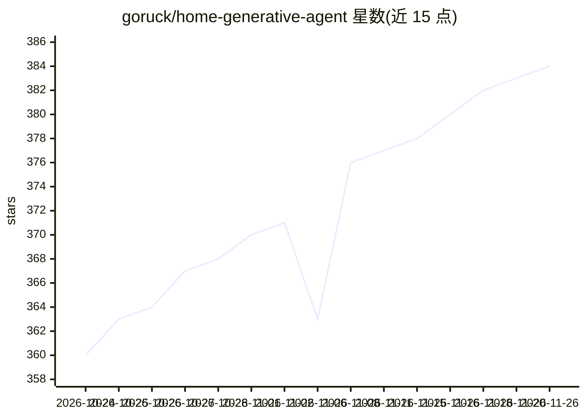

# goruck/home-generative-agent

⭐ 384 · Python · MIT · 推送 2026-11-25 · [GitHub](https://github.com/goruck/home-generative-agent) · [官网](https://community.home-assistant.io/t/a-generative-agent-integration-based-on-langchain-and-langgraph/864923) · 个人维护

**Home Assistant 的生成式 AI agent 集成：对话控制家居并分析摄像头**

一个 Home Assistant 集成，基于 LangGraph 构建 agent，通过工具调用控制 HA 实体、查询历史、分析摄像头画面并用自然语言创建自动化（由 agent 生成 YAML 并注册）。提供 pgvector 长期语义记忆、Sentinel 确定性异常规则引擎与人脸识别（可选 face-service）、内置 STT/TTS 流水线。支持云模型（OpenAI/Gemini/Anthropic）或全本地（Ollama/OpenAI 兼容服务器）。需 Home Assistant 2026.8+、HACS 或手动安装，以及 PostgreSQL with pgvector。

## 筛选速览

| 维度 | 判定 | 备注 |
|---|---|---|
| AI 角色 | `ai-native` | 本体是模型或模型工具 |
| 许可风险 | `permissive` | MIT |
| 部署形态 | `None` |  |
| 模型依赖 | local-ok | 支持本地模型 |
| 硬件要求 | — | 无带数字的原话,不猜 |
| 安装摩擦 | `low` | 无编译、无系统依赖或容器化 |
| 成熟度 | — | 结构信号不足 |

## 能力要点

- 基于 LangGraph 的 agent，用工具控制实体、写真实 HA 自动化
- pgvector 长期语义记忆，跨对话记住偏好
- Sentinel 异常引擎：确定性规则告警，LLM 只建议不执行
- 内置 STT/TTS，支持 OpenAI API 或本地 Speaches/faster-whisper

## 适用场景

- 用自然语言对话控制家电并创建自动化
- 摄像头运动触发分析与陌生人识别告警
- 全本地部署让智能家居数据不出家门
- 对家居安全状态做定期审计与异常提醒

## 场景标签

`聊天机器人` `语音 Agent` `人脸识别` · 领域:对话与助手

## 证据(README 行号)

> L13: A Home Assistant integration that brings a generative AI agent into your smart home. Talk to your home, create auto
> L21: Most AI conversation integrations are prompt passthroughs: they forward your words to an LLM and read back the answ

## 星数曲线

2026-10-24 360 → 2026-11-26 384（+24）

---
*卡片 v1 · prompt 1.4 · 生成 2026-11-25 · 置信度 high · 依据 README sha `90e2965298ec` · [字段定义](../../DATASET.md)*
