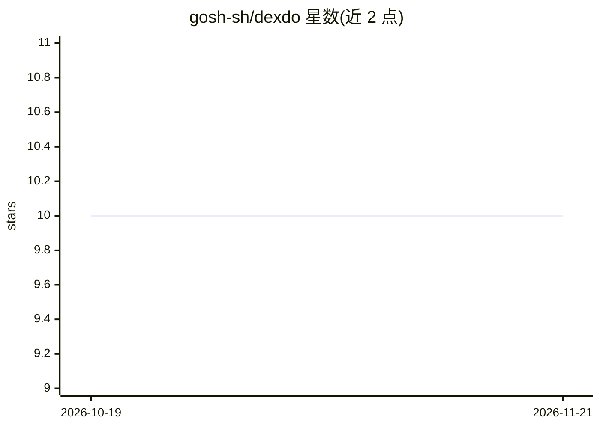

# gosh-sh/dexdo

⭐ 10 · Rust · AGPL-3.0 · 推送 2026-11-20 · [GitHub](https://github.com/gosh-sh/dexdo) · [官网](https://gosh-sh.github.io/dexdo/) · 组织维护

**运行在 Acki Nacki 链上的 DEX 后端，由 AI agent 驱动操作**

DEX.DO 去中心化交易所的后端，由两个 Rust 服务组成：HTTP API 服务与链上事件索引器，共享 Postgres 读模型；仓库另含链上合约与 SDK（halo2 zk 证明管线）。运作流程设计为 agent-driven：用户向拥有 shell 权限的 AI 编码代理（Claude Code、Cursor 等）粘贴单行提示词，代理按 .claude/skills/ 中的技能逐步完成钱包部署、注资、注册、行情读取、交易与提款。托管测试后端不保证委托密钥安全，仅限 Shellnet 测试。AGPLv3 许可。

## 筛选速览

| 维度 | 判定 | 备注 |
|---|---|---|
| AI 角色 | `ai-enhanced` | 去掉 AI 部分产品仍成立 |
| 许可风险 | `viral` | AGPL-3.0 |
| 部署形态 | `self-host` | docker 或自建部署 |
| 模型依赖 | — | README 未给出锁定关系 |
| 硬件要求 | — | 无带数字的原话,不猜 |
| 安装摩擦 | `low` | 无编译、无系统依赖或容器化 |
| 成熟度 | — | 结构信号不足 |

## 能力要点

- api/indexer 双 Rust 服务共享 Postgres 读模型
- 全套生命周期通过单行提示词由 AI agent 驱动执行
- OpenAPI 3.1 契约从 Rust handler 生成
- SDK 含 halo2 zk 证明管线，独立 Cargo workspace

## 适用场景

- 在 Shellnet 测试网上体验 Acki Nacki 链上的预测/交易市场
- 让 AI 编码代理代为完成链上钱包部署、交易与提款
- 自托管 indexer 与 API 接入自己的 GraphQL 端点和 Postgres

## 场景标签

 · 领域:区块链/DeFi

## 证据(README 行号)

> L12: DEX.DO is **agent-driven**: an AI coding agent with shell access to this repo runs the whole flow — onboarding, reg
> L16: - An AI agent with shell + repo access (Claude Code, Cursor, …).

## 星数曲线

2026-10-19 10 → 2026-11-21 10（+0）

---
*卡片 v1 · prompt 1.4 · 生成 2026-11-19 · 置信度 high · 依据 README sha `f0e7d59f4d35` · [字段定义](../../DATASET.md)*
