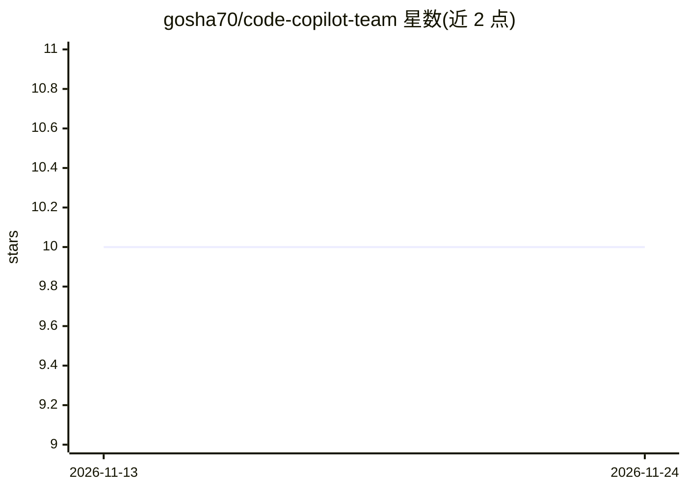

# gosha70/code-copilot-team

⭐ 10 · Python · MIT · 推送 2026-11-23 · [GitHub](https://github.com/gosha70/code-copilot-team) · [官网](https://gosha70.github.io/code-copilot-team/) · 个人维护

**给开发者提供多 agent 编码规则与安全护栏的统一 harness**

面向 AI 辅助编码的约束执行框架：一次安装规则、工作流与安全护栏，使多个编码 agent 以一致方式遵守。Claude Code 与 Pi 在运行时以 hooks 强制执行（可拦截操作），Cursor、Codex、Copilot、Windsurf、Aider 则以规则文件形式读取（advisory）。核心机制包括规格驱动开发、Research→Plan→Build→Review 四阶段门禁流程、第二模型交叉评审（PASS/FAIL/INCONCLUSIVE 判定契约）、带花费与时间上限的无人值守构建及决策账本。通过 git clone 加 setup.sh 安装并按目标工具选择适配器。

## 筛选速览

| 维度 | 判定 | 备注 |
|---|---|---|
| AI 角色 | `ai-ecosystem` | LLM/agent 周边工具 |
| 许可风险 | `permissive` | MIT |
| 部署形态 | `None` |  |
| 模型依赖 | — | README 未给出锁定关系 |
| 硬件要求 | — | 无带数字的原话,不猜 |
| 安装摩擦 | `low` | 无编译、无系统依赖或容器化 |
| 成熟度 | — | 结构信号不足 |

## 能力要点

- hooks 强制执行：Claude Code 15 项、Pi 8 项特性可在运行时拦截
- 跨 provider 同行评审：第二模型按固定判定契约输出 PASS/FAIL/INCONCLUSIVE
- 无人值守 auto-build：花费/时间/轮次上限与决策账本（beta）
- 会话与成本数据入本地存储并提供 web UI 查询

## 适用场景

- 让多个编码 agent 遵守同一套团队编码规范与安全约束
- 在阶段完成前强制通过验证与第二模型评审
- 在花费与时间上限下无人值守地按规格构建特性

## 场景标签

`编码 Agent` `代码审查` `多智能体` · 领域:Agent 开发

## 证据(README 行号)

> L8: An enforceable harness for AI-assisted coding: your rules, your workflow and your safety rails, applied the same way
> L25: - **Rules that hold.** Coding standards, safety constraints and conventions install once and load in every session,
> L63: |`pi`|**8 features enforced** — a gate that can block — and 7 more as rules it reads|`./scripts/setup.sh --pi`|

## 星数曲线

2026-11-13 10 → 2026-11-24 10（+0）

---
*卡片 v1 · prompt 1.4 · 生成 2026-11-19 · 置信度 high · 依据 README sha `383646cd3bec` · [字段定义](../../DATASET.md)*
