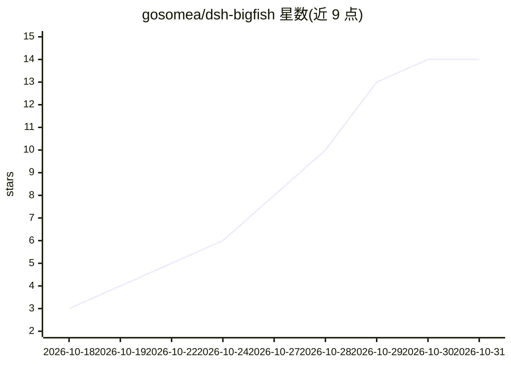

# gosomea/dsh-bigfish

⭐ 14 · TypeScript · NOASSERTION · 推送 2026-10-08 · [GitHub](https://github.com/gosomea/dsh-bigfish) · [官网](https://www.npmjs.com/package/dsh-bigfish) · 个人维护 · 中文 README

**DeepSeek Harness Web 的陪伴宠物插件，动画跟随 Agent 任务状态**

运行于 DeepSeek Harness（DSH）Web 界面的可拖动桌面宠物插件：内置大肥鱼角色提供 101 类动作（含 72 段新增动画、432 个新绘制姿态、18 种举牌演出），按任务状态（等待输出、执行工具、等待确认、完成/出错）切换动画与气泡台词，并按模型输出速度自适应节奏（约 20～400 tok/s 分通道学习）。支持 160 句可编辑台词、可关闭的鞭策动作、安静模式、备份恢复与可替换 .dshpet 角色包；附带 dsh-bigfish-pet-maker Skill 供 Agent 制作角色。限制：Windows、x86、Safari/Firefox 等平台尚未验证；需先安装 DSH 宿主。

## 筛选速览

| 维度 | 判定 | 备注 |
|---|---|---|
| AI 角色 | `ai-enhanced` | 去掉 AI 部分产品仍成立 |
| 许可风险 | `none` | NOASSERTION |
| 部署形态 | `library` | 以包/库形式分发 |
| 模型依赖 | — | README 未给出锁定关系 |
| 硬件要求 | — | 无带数字的原话,不猜 |
| 安装摩擦 | `low` | 无编译、无系统依赖或容器化 |
| 成熟度 | — | 结构信号不足 |

## 能力要点

- 101 类内置动作，按任务状态与工具调用切换动画与气泡台词
- 按 provider/model 分通道学习输出速度并自适应动画节奏
- 可替换 .dshpet 角色包，含模板、校验器与打包工具的 pet-maker Skill
- 160 句可编辑台词、鞭策可整体关闭、深浅主题与备份恢复

## 适用场景

- 在 DSH Web 界面工作时获得动画陪伴，直观看到 Agent 任务状态
- 用 Agent 配合 pet-maker Skill 制作并导入自定义宠物角色
- 按个人偏好调整陪伴强度：活泼互动或安静陪同

## 场景标签

 · 领域:Agent 生态/桌面陪伴工具

## 证据(README 行号)

> L7: 一个装在 **DeepSeek Harness Web** 里的可拖动宠物，支持替换角色、制作动作和自定义台词。
> L83: |看着模型输出|敲键盘、思考，跟随当前模型的相对速度调整节奏|

## 星数曲线

2026-10-18 3 → 2026-10-31 14（+11）

---
*卡片 v1 · prompt 1.4 · 生成 2026-10-31 · 置信度 high · 依据 README sha `169dc6ea12ea` · [字段定义](../../DATASET.md)*
