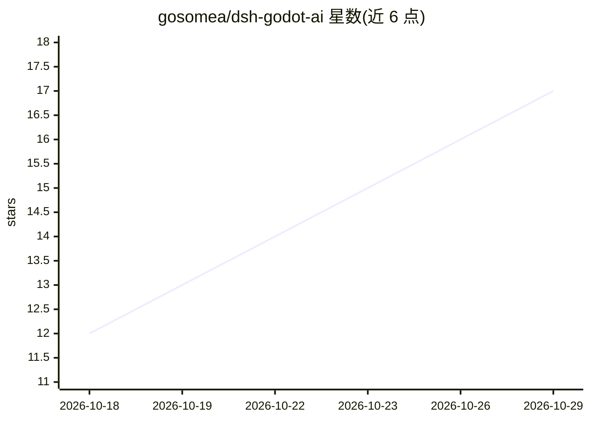

# gosomea/dsh-godot-ai

⭐ 17 · TypeScript · MIT · 推送 2026-10-07 · [GitHub](https://github.com/gosomea/dsh-godot-ai) · 个人维护 · 中文 README

**给 DeepSeek Harness 加 Godot Creator 模式，AI 搭建并验证 Godot 游戏**

DeepSeek Harness（DSH）的插件包，新增一个 Godot Creator 预设：用户描述玩法，模型通过原版 Godot AI 操作打开的 Godot 编辑器，创建场景、脚本、UI，运行游戏并回读验证。提供游戏创作台、16 个内置 Godot Skills、3 个工作流和带签名与风险分级的第三方 Skill 市场。编辑器操作由需手动安装的 Godot AI Addon（固定 3.1.5 后端）完成，插件本身提供模式配置、对话规则、知识与界面，不替代游戏引擎。要求 DSH 0.2.0-rc.2 Web、Node.js 22.x/24+、uvx、Godot 4.5+。作者声明未做端到端游戏生成验证。

## 筛选速览

| 维度 | 判定 | 备注 |
|---|---|---|
| AI 角色 | `ai-ecosystem` | LLM/agent 周边工具 |
| 许可风险 | `permissive` | MIT |
| 部署形态 | `library` | 以包/库形式分发 |
| 模型依赖 | locked-api |  |
| 硬件要求 | — | 无带数字的原话,不猜 |
| 安装摩擦 | `low` | 无编译、无系统依赖或容器化 |
| 成熟度 | `idea` | |

## 能力要点

- 读取→小批次修改→回读→运行→验证的工作循环，失败可从已验证阶段恢复
- 16 个内置 Godot Skills，可被项目/用户同名 Skill 按作用域覆盖
- 第三方 Skill 市场：Ed25519 签名、风险分级硬阻断、保留三版历史用于回滚
- 原生 PTC 将模型直接调用入口收敛到 run_code

## 适用场景

- 用自然语言让 AI 在 Godot 编辑器中搭建 2D/3D 游戏原型
- 在 DeepSeek Harness 中管理 Godot 游戏开发 Skills
- 通过 Skill 市场审阅、安装和回滚第三方游戏开发知识

## 场景标签

`GUI 自动化` · 领域:效率与自动化

## 证据(README 行号)

> L1: description: "在 DeepSeek Harness 中用一个 Godot Creator 模式读取、构建和验证 Godot 游戏，并管理游戏开发 Skills。"
> L10: 给 DeepSeek Harness 增加一个专门做 Godot 游戏的 **Godot Creator** 模式。你描述玩法，AI 通过原版 Godot AI 操作当前打开的编辑器，搭场景、改脚本、制作 UI，再运行并检查结果。
> L75: Godot 编辑器操作由原版 Godot AI 实现；这个插件负责 DSH 模式、对话规则、知识、工作流和界面，不替代游戏引擎，也不保证一句话就完成整款游戏。

## 星数曲线

2026-10-18 12 → 2026-10-29 17（+5）

---
*卡片 v1 · prompt 1.4 · 生成 2026-10-29 · 置信度 high · 依据 README sha `6f759e91e40d` · [字段定义](../../DATASET.md)*
