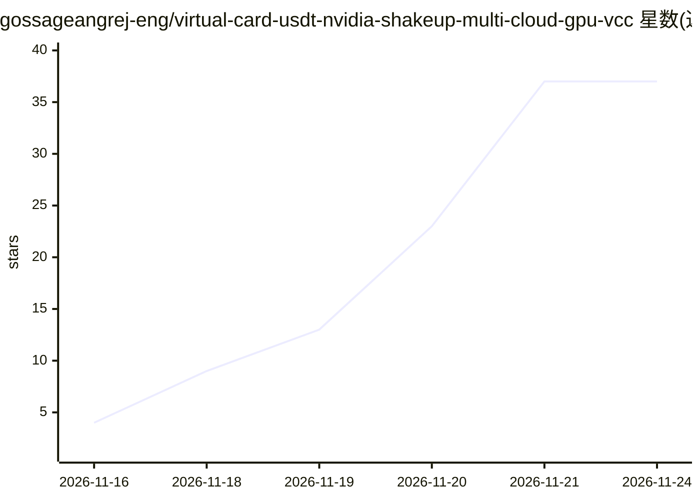

# gossageangrej-eng/virtual-card-usdt-nvidia-shakeup-multi-cloud-gpu-vcc

⭐ 60 · 推送 2026-11-16 · [GitHub](https://github.com/gossageangrej-eng/virtual-card-usdt-nvidia-shakeup-multi-cloud-gpu-vcc) · [官网](https://app.coregold.io/signup?invite_code=ADvlj9b) · 个人维护

**面向 ML 工程师的云 GPU 租用支付风险管理指南**

一份技术指南，说明在 RunPod、Lambda Labs、Oracle OCI 等云平台租用 GPU 时，如何使用 CoreGold USDT 虚拟卡管理计费：通过发行方硬性消费上限在训练脚本失控或忘记释放实例时触发拒付，支持 USDT（TRC20/ERC20）充值实时转美元、签发美国商业 Visa/Mastercard BIN 卡，并可绑定 Apple Pay 支付。内容以三步设置流程呈现，附注册控制台链接。

## 筛选速览

| 维度 | 判定 | 备注 |
|---|---|---|
| AI 角色 | `ai-knowledge` | 知识聚合/清单类 |
| 许可风险 | `none` | — |
| 部署形态 | `None` |  |
| 模型依赖 | — | README 未给出锁定关系 |
| 硬件要求 | — | 无带数字的原话,不猜 |
| 安装摩擦 | `low` | 无编译、无系统依赖或容器化 |
| 成熟度 | — | 结构信号不足 |

## 能力要点

- 虚拟卡可设置硬性消费上限，超限自动拒付以暂停释放 GPU 实例
- 支持 USDT（TRC20/ERC20）充值并实时转换为美元
- 提供美国商业 BIN 卡与配套 AVS 地址信息
- 卡可加入 Apple Wallet 并经 Apple Pay 支付

## 适用场景

- 跨多个 GPU 云平台租用 H100/B200 实例时控制计费风险
- 为限时训练任务签发带固定额度的专用卡
- 向 ChatGPT Pro 或 Claude 等订阅服务付款

## 场景标签

 · 领域:云基础设施/支付管理

## 证据(README 行号)

> L2: Amidst global GPU supply-chain volatility following NVIDIA's leadership shakeup, this technical guide shows ML engin
> L9: ### 1. Why ML Engineers Use CoreGold as a Hardware Compute Fuse
> L20: - **Step 1**: Sign up at CoreGold Console and deposit **USDT** under **Asset Management**.

## 星数曲线

2026-11-16 4 → 2026-11-24 37（+33）

---
*卡片 v1 · prompt 1.4 · 生成 2026-11-19 · 置信度 mid · 依据 README sha `a9c4821bf9be` · [字段定义](../../DATASET.md)*
