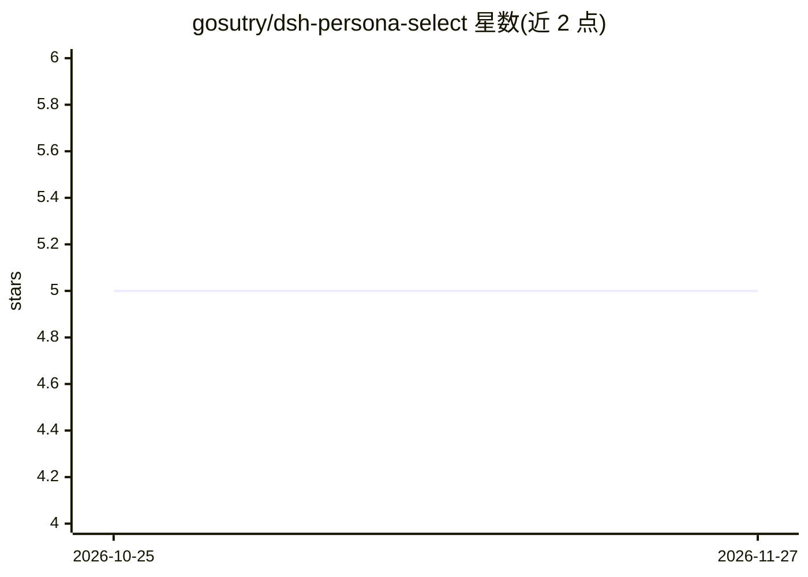

# gosutry/dsh-persona-select

⭐ 5 · JavaScript · MIT · 推送 2026-11-26 · [GitHub](https://github.com/gosutry/dsh-persona-select) · 个人维护 · 中文 README

**为 DSH 宿主注入系统提示词与上下文的插件，附人设管理**

该插件面向 DSH（DeepSeek Harness）宿主，负责两件事：将人设正文注入系统提示词、将历史对话在新对话第一步以 user 侧上下文注入一次。提供人设的增删改存、段序权重排序、按会话与全局分离的设置、四个屏蔽开关（可组合成纯聊天模式）、JSON/PNG 角色卡导出导入，以及直接读取 DSH /export 会话日志。历史对话不重复注入以保留 KV 缓存；需 DSH 宿主环境运行，README 未给出安装命令。

## 筛选速览

| 维度 | 判定 | 备注 |
|---|---|---|
| AI 角色 | `ai-ecosystem` | LLM/agent 周边工具 |
| 许可风险 | `permissive` | MIT |
| 部署形态 | `None` |  |
| 模型依赖 | — | README 未给出锁定关系 |
| 硬件要求 | — | 无带数字的原话,不猜 |
| 安装摩擦 | `low` | 无编译、无系统依赖或容器化 |
| 成熟度 | — | 结构信号不足 |

## 能力要点

- 人设正文注入系统提示词，段序权重可编辑排序
- 历史对话仿 DSH 格式包裹后在新对话首步注入一次
- 四个屏蔽开关可组合为一键纯聊天，屏蔽全部系统侧输入
- 支持 JSON/PNG 角色卡导入导出与 DSH /export 会话日志导入

## 适用场景

- 为 DSH 会话保存并快速切换不同人设预设
- 屏蔽宿主侧系统注入，只与模型纯聊天以降低 token 消耗
- 把既有会话日志转成可复用的人设历史对话
- 用 PNG 角色卡分享人设设定

## 场景标签

`提示工程` · 领域:Agent 开发

## 证据(README 行号)

> L3: > DSH 插件：把人设正文注入**系统提示词**，把历史对话注入**上下文**。设置页的人设管理负责保存与编辑，对话模式选择行下方可以随时切换人设。
> L48: 四个开关各自撤掉一类模型本来能看到的**系统侧输入**：

## 星数曲线

2026-10-25 5 → 2026-11-27 5（+0）

---
*卡片 v1 · prompt 1.4 · 生成 2026-11-21 · 置信度 high · 依据 README sha `64fa6a294c9b` · [字段定义](../../DATASET.md)*
