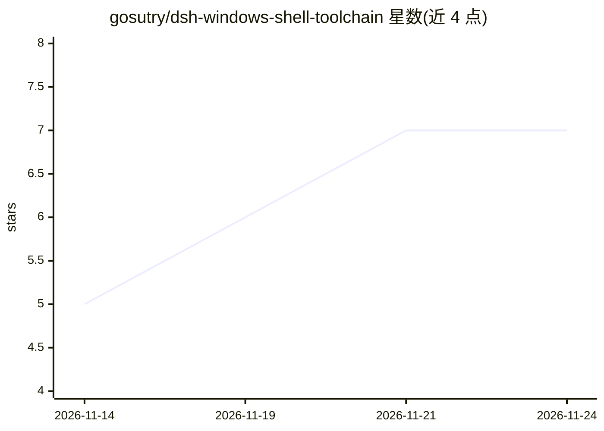

# gosutry/dsh-windows-shell-toolchain

⭐ 7 · PowerShell · MIT · 推送 2026-11-16 · [GitHub](https://github.com/gosutry/dsh-windows-shell-toolchain) · 个人维护 · 中文 README

**给 DeepSeek Harness 在 Windows 配置可用 bash 执行器的 agent skill**

一个面向 DSH 的 agent skill，由文档与 PowerShell 脚本组成：检测机器上已有的 bash/PowerShell 7，缺哪个装哪个（默认装无 POSIX 模拟层的 niubash，备选 PortableGit），并把 DSH profile 的执行器改为带 sandboxMode 的 bash-sandbox，双执行器各占一个 realm。解决 MSYS 系 bash 在受限沙箱下无法启动 signal pipe 的问题。无需管理员权限，改动记录快照，restore.ps1 可逐字节回滚配置与 PATH。不覆盖 x86 平台，升级需手动确认且需重启 DSH。

## 筛选速览

| 维度 | 判定 | 备注 |
|---|---|---|
| AI 角色 | `ai-ecosystem` | LLM/agent 周边工具 |
| 许可风险 | `permissive` | MIT |
| 部署形态 | `desktop` | 安装包/桌面程序 |
| 模型依赖 | locked-api |  |
| 硬件要求 | — | 无带数字的原话,不猜 |
| 安装摩擦 | `low` | 无编译、无系统依赖或容器化 |
| 成熟度 | — | 结构信号不足 |

## 能力要点

- 受限沙箱下可用的原生 bash（niubash）自动安装与 PATH 接管
- profile 双执行器补丁：bash 与 pwsh 各占一个 realm，带结构校验与旧格式原地替换
- 内置 gh-proxy 等镜像测速选源、sha256 校验、断流自动换源
- 快照快照式回滚：restore.ps1 逐字节还原配置与用户 PATH，支持 -Uninstall -DeleteTools

## 适用场景

- 在 Windows 上让 DSH 的 tool-bash 在 workspace-write/read-only 沙箱中正常运行
- 换机或重装时用快照把 profile 与 PATH 回滚到改动前
- 网络受限环境下通过镜像测速下载 Git/PowerShell 7 便携包

## 场景标签

`编码 Agent` · 领域:编码与开发

## 证据(README 行号)

> L3: > 给 **DeepSeek Harness (DSH)** 在 Windows 上配一个真正的 bash 执行器，并补上 PowerShell 7 便携版。**不需要管理员**。
> L13: 一个 **agent skill**（不是插件）：一份能被任意 agent 读懂并执行的文档 + 一组可直接运行的 PowerShell 脚本。

## 星数曲线

2026-11-14 5 → 2026-11-24 7（+2）

---
*卡片 v1 · prompt 1.4 · 生成 2026-11-20 · 置信度 high · 依据 README sha `4e9bbfd80284` · [字段定义](../../DATASET.md)*
