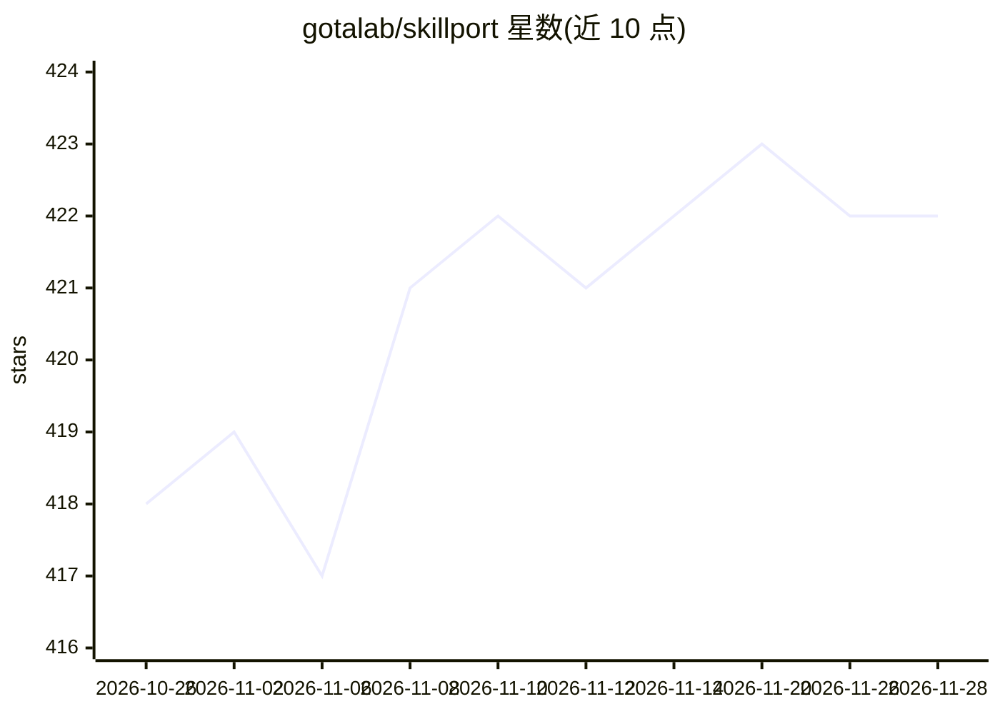

# gotalab/skillport

⭐ 422 · Python · MIT · 推送 2026-10-25 · [GitHub](https://github.com/gotalab/skillport) · 组织维护

**Agent Skills 的验证、管理与分发工具，经 CLI 或 MCP 服务于各类 AI agent**

SkillPort 是面向 Agent Skills 规范的 SkillOps 工具：按规范校验技能（可输出 CI 友好的 JSON）、从 GitHub 等来源安装技能、以元数据命令批量维护，并通过 CLI 模式（生成 AGENTS.md 技能表、按需加载）或 MCP 服务器（search_skills/load_skill，先搜索后加载以控制上下文消耗）向 agent 交付技能。支持按类别/标签对客户端过滤暴露技能。以 uv/pip 安装，MCP 模式需另装 skillport-mcp。开发状态标注为进行中，API 可能变动。

## 筛选速览

| 维度 | 判定 | 备注 |
|---|---|---|
| AI 角色 | `ai-ecosystem` | LLM/agent 周边工具 |
| 许可风险 | `permissive` | MIT |
| 部署形态 | `library` | 以包/库形式分发 |
| 模型依赖 | — | README 未给出锁定关系 |
| 硬件要求 | — | 无带数字的原话,不猜 |
| 安装摩擦 | `low` | 无编译、无系统依赖或容器化 |
| 成熟度 | `idea` | |

## 能力要点

- 按 Agent Skills 规范校验技能，支持 CI 中 JSON 输出
- MCP 服务器采用先搜索后加载模式，每技能约 100 token 元数据
- 从 GitHub URL 一键安装技能并做全生命周期管理
- 按类别/标签对不同客户端过滤暴露技能

## 适用场景

- 为不支持原生技能的编码 agent 通过 MCP 提供 Agent Skills
- 在 CI 中校验技能是否符合规范后再部署
- 管理团队内大量技能的元数据一致性
- 为自研 AI agent 提供技能检索与按需加载能力

## 场景标签

`提示工程` · 领域:Agent 开发

## 证据(README 行号)

> L5: SkillOps = Validate, manage, and deliver skills at scale.
> L16: |Build your own AI agent|Provides MCP server, CLI, and Python library|
> L61: MCP server for clients that don't natively support Agent Skills.

## 星数曲线

2026-10-26 418 → 2026-11-28 422（+4）

---
*卡片 v1 · prompt 1.4 · 生成 2026-11-25 · 置信度 high · 依据 README sha `11c09a81065f` · [字段定义](../../DATASET.md)*
