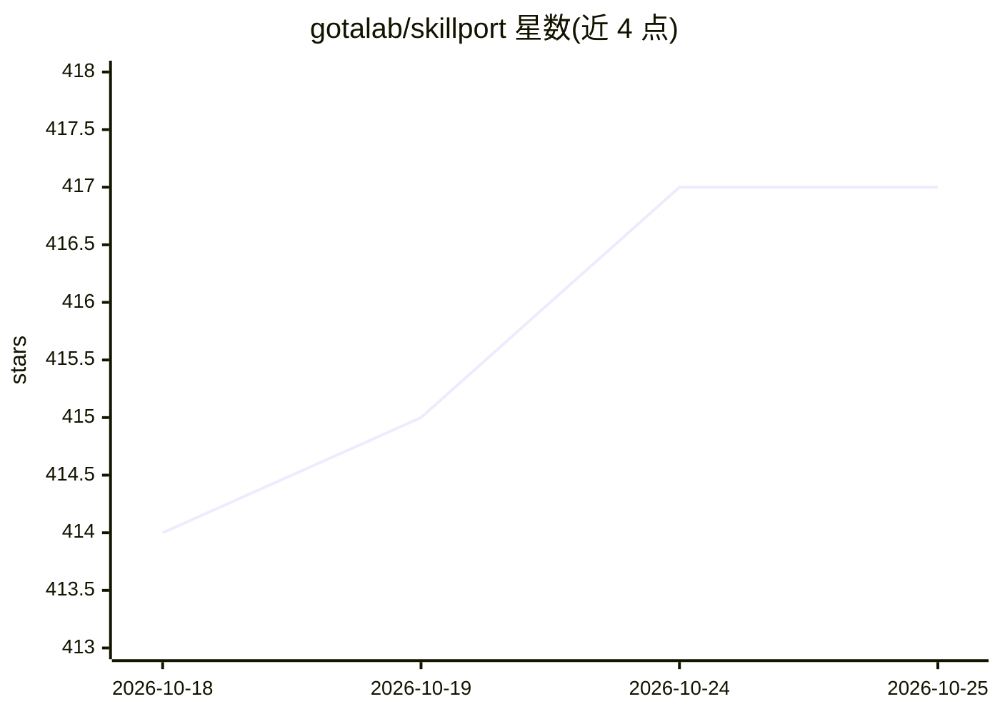

# gotalab/skillport

⭐ 417 · Python · MIT · 推送 2026-06-24 · [GitHub](https://github.com/gotalab/skillport) · 组织维护

**面向 AI/coding agent 的技能管理工具：校验、分发、MCP 托管**

SkillPort 是一个 Python 编写的 SkillOps 工具包，用于按 Agent Skills 规范批量校验、管理并分发技能：支持从 GitHub 等来源添加技能、程序化读写技能元数据、在 CI 中校验；通过 MCP server 或 CLI 两种模式把技能交付给 Cursor、Copilot、Codex、Claude Code 等客户端，采用 Tool Search Tool 模式——仅加载技能元数据（约 100 tokens/技能），按需加载完整指令。提供 pip/uv 安装、一键接入常用客户端。README 自述开发状态为进行中，API 可能变更。

## 筛选速览

| 维度 | 判定 | 备注 |
|---|---|---|
| AI 角色 | `ai-ecosystem` | LLM/agent 周边工具 |
| 许可风险 | `permissive` | MIT |
| 部署形态 | `library` | 以包/库形式分发 |
| 模型依赖 | — | README 未给出锁定关系 |
| 硬件要求 | — | 无带数字的原话,不猜 |
| 安装摩擦 | `low` | 无编译、无系统依赖或容器化 |
| 成熟度 | `idea` | |

## 能力要点

- 按 Agent Skills 规范校验技能，支持 CI 友好 JSON 输出
- MCP server 与 CLI 两种分发模式，兼容 Cursor/Copilot/Windsurf/Cline/Codex 等
- 搜索优先加载：仅加载元数据约 100 tokens/技能，按需加载完整指令
- 分类/标签/命名空间过滤与按客户端差异化暴露技能

## 适用场景

- 为不原生支持 Agent Skills 的 coding agent 提供技能接入
- 团队统一管理 50+ 技能并在 CI 中校验部署
- 不同 agent 客户端按类别暴露不同技能子集

## 场景标签

`Agent 框架` · 领域:Agent 开发

## 证据(README 行号)

> L3: **The SkillOps Toolkit for Agent Skills**
> L61: MCP server for clients that don't natively support Agent Skills.
> L72: Works with Cursor, Copilot, Windsurf, Cline, Codex, and any MCP-compatible client.

## 星数曲线

2026-10-18 414 → 2026-10-25 417（+3）

---
*卡片 v1 · prompt 1.4 · 生成 2026-10-21 · 置信度 high · 依据 README sha `13f53736b00b` · [字段定义](../../DATASET.md)*
