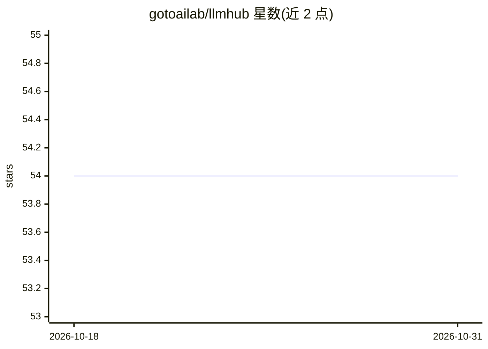

# gotoailab/llmhub

⭐ 54 · Go · MIT · 推送 2025-12-13 · [GitHub](https://github.com/gotoailab/llmhub) · 组织维护 · 中文 README

**Golang 统一 LLM API 客户端库：一个接口调用 20+ 提供商**

用 Golang 编写的 LLM API 客户端库，提供与 OpenAI API 格式兼容的统一接口，支持国际（OpenAI/Claude/Gemini 等）、国内（Qwen/文心一言/混元等 13 家）及本地 Ollama 共 20+ 提供商。核心 API 为 NewClient 创建客户端、ChatCompletions 非流式与 ChatCompletionsStream 流式对话，附完整类型定义。以库形式直接 import 到项目，go get 安装，MIT 许可。

## 筛选速览

| 维度 | 判定 | 备注 |
|---|---|---|
| AI 角色 | `ai-ecosystem` | LLM/agent 周边工具 |
| 许可风险 | `permissive` | MIT |
| 部署形态 | `None` |  |
| 模型依赖 | local-ok | 支持本地模型 |
| 硬件要求 | — | 无带数字的原话,不猜 |
| 安装摩擦 | `low` | 无编译、无系统依赖或容器化 |
| 成熟度 | — | 结构信号不足 |

## 能力要点

- OpenAI 兼容接口统一接入 20+ LLM 提供商
- 支持流式输出（ChatCompletionsStream）
- 完整的 Go 类型定义
- 覆盖国际/国内/本地（Ollama）三类提供商

## 适用场景

- Go 项目中切换或混用多个 LLM 提供商而不改代码
- 用同一套类型定义处理不同模型的对话请求
- 接入国内大模型（通义千问/文心一言/混元等）做统一封装

## 场景标签

`模型网关` · 领域:Agent 开发

## 证据(README 行号)

> L5: LLMHub is a unified LLM API client library developed in Golang, providing OpenAI API-compatible interfaces and suppo
> L10: - ✅ **Multi-Model Support**: Supports 20+ LLM providers

## 星数曲线

2026-10-18 54 → 2026-10-31 54（+0）

---
*卡片 v1 · prompt 1.4 · 生成 2026-10-24 · 置信度 high · 依据 README sha `b1ed7dc53ff9` · [字段定义](../../DATASET.md)*
