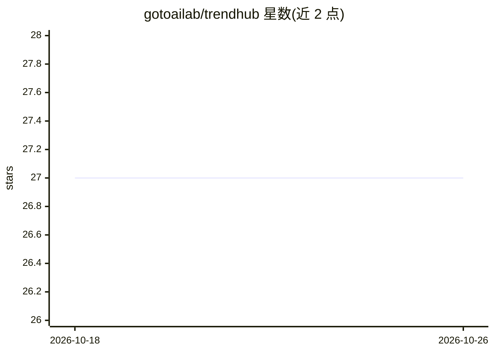

# gotoailab/trendhub

⭐ 27 · HTML · 推送 2025-12-03 · [GitHub](https://github.com/gotoailab/trendhub) · [官网](https://trendhub.wowwwow.cn) · 组织维护 · 中文 README

**热点趋势监控与推送平台：多平台采集、关键词过滤、多渠道推送**

用 Go 编写的热点趋势监控与管理系统：从微博、知乎、百度、B站、抖音等 11+ 平台采集热搜数据，按关键词规则（必须词/过滤词/普通词，组间 OR 组内 AND）过滤，经多维度加权排序后通过飞书、钉钉、企业微信、Telegram、Bark、Ntfy、SMTP 邮件等渠道推送。提供 daily/current/incremental 三种工作模式、Web 管理界面（可视化配置、配置热重载）与命令行模式。过滤与排序为规则和权重算法，README 未展示 LLM 调用。

## 筛选速览

| 维度 | 判定 | 备注 |
|---|---|---|
| AI 角色 | `ai-enhanced` | 去掉 AI 部分产品仍成立 |
| 许可风险 | `none` | — |
| 部署形态 | `None` |  |
| 模型依赖 | — | README 未给出锁定关系 |
| 硬件要求 | — | 无带数字的原话,不猜 |
| 安装摩擦 | `low` | 无编译、无系统依赖或容器化 |
| 成熟度 | — | 结构信号不足 |

## 能力要点

- 11+ 平台热搜采集，三种工作模式（daily/current/incremental）
- 必须词/过滤词/普通词关键词规则与优先级加权排序
- 7 类推送渠道（飞书/钉钉/企业微信/Telegram/Bark/Ntfy/邮件）
- Web 管理界面支持可视化配置编辑与配置热重载

## 适用场景

- 按自定义关键词订阅多平台热点并推送到 IM
- 每日定时汇总新闻报告或突发事件实时追踪
- 长期跟踪特定话题，增量去重推送避免重复打扰

## 场景标签

`网页抓取` `工作流自动化` · 领域:效率与自动化

## 证据(README 行号)

> L30: - **多平台支持** - 11+ 热门平台数据采集
> L32: - **智能过滤** - 支持必须词、过滤词、普通词

## 星数曲线

2026-10-18 27 → 2026-10-26 27（+0）

---
*卡片 v1 · prompt 1.4 · 生成 2026-10-26 · 置信度 mid · 依据 README sha `4a6bab813263` · [字段定义](../../DATASET.md)*
