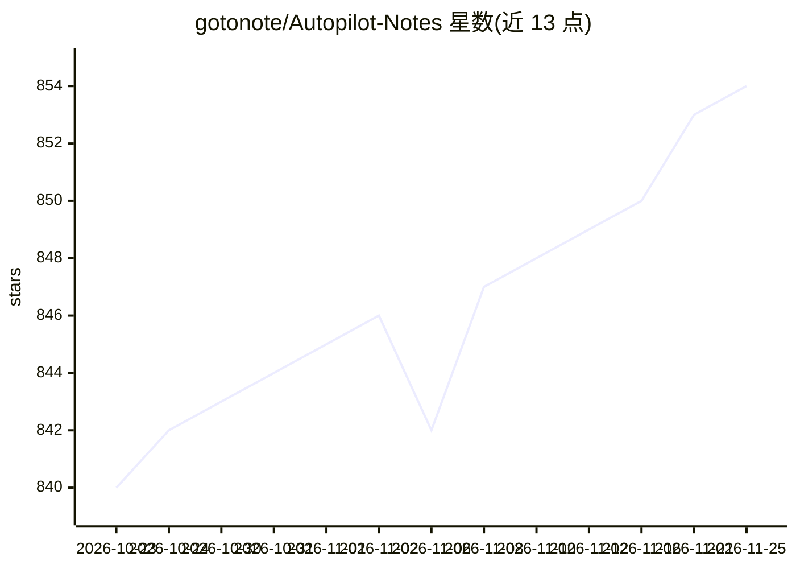

# gotonote/Autopilot-Notes

⭐ 854 · Shell · Apache-2.0 · 推送 2026-10-30 · [GitHub](https://github.com/gotonote/Autopilot-Notes) · 个人维护 · 中文 README

**自动驾驶全栈知识点学习笔记与行业日报知识库**

面向学习自动驾驶技术的开发者整理的开源笔记仓库，内容按 10+ 章节组织：基础（坐标系/滤波/Transformer/强化学习）、硬件、感知（BEV、Occupancy）、定位、规划、控制、产品、工具、厂商方案。工作日 19:00 自动生成技术日报，覆盖厂商方案与前沿动态；欢迎社区以 PR 形式补充内容。MIT 许可证。README 未提供可运行的程序或安装步骤，仅提供文档阅读。

## 筛选速览

| 维度 | 判定 | 备注 |
|---|---|---|
| AI 角色 | `ai-knowledge` | 知识聚合/清单类 |
| 许可风险 | `permissive` | Apache-2.0 |
| 部署形态 | `None` |  |
| 模型依赖 | — | README 未给出锁定关系 |
| 硬件要求 | — | 无带数字的原话,不猜 |
| 安装摩擦 | `low` | 无编译、无系统依赖或容器化 |
| 成熟度 | — | 结构信号不足 |

## 能力要点

- 10+ 章节覆盖感知、定位、规划、控制全栈知识点
- 工作日 19:00 自动更新的技术日报，7 天后自动归档
- 收录 Tesla、百度 Apollo、华为 ADS、小鹏 XNGP 等厂商方案解析
- 包含 CARLA/PreScan 仿真与 TensorRT 部署等工程实践内容

## 适用场景

- 从零系统学习自动驾驶各模块知识
- 跟踪每日自动驾驶行业前沿动态
- 了解各家厂商智驾方案与芯片专题
- 查阅仿真与部署加速的实践笔记

## 场景标签

`教程课程` · 领域:学习与行业

## 证据(README 行号)

> L17: 随着各大科技公司积极布局，**自动驾驶**成为新的技术风口。本仓库旨在系统性总结和分享自动驾驶技术方案，帮助开发者从入门到进阶全面掌握相关知识。
> L21: - 📚 **体系完整** - 涵盖基础理论、硬件、算法、工具、实践等 10+ 章节
> L22: - 🔄 **每日更新** - 技术日报 工作日 19:00 自动推送行业最新动态

## 星数曲线

2026-10-23 840 → 2026-11-25 854（+14）

---
*卡片 v1 · prompt 1.4 · 生成 2026-11-24 · 置信度 high · 依据 README sha `261c7a155332` · [字段定义](../../DATASET.md)*
