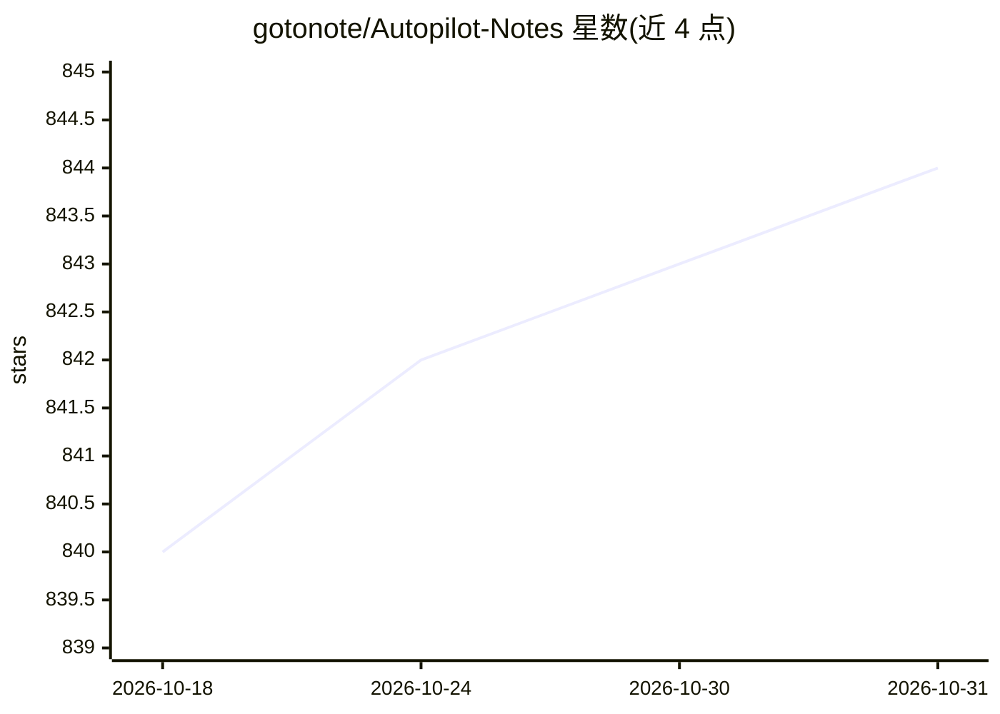

# gotonote/Autopilot-Notes

⭐ 844 · Shell · Apache-2.0 · 推送 2026-10-30 · [GitHub](https://github.com/gotonote/Autopilot-Notes) · 个人维护 · 中文 README

**自动驾驶技术全栈知识库笔记：感知到控制各模块讲解**

系统性组织自动驾驶技术学习笔记的开源知识库，按基础、硬件、感知、定位、规划、控制、产品、工具、厂商方案等 10 个章节展开，涵盖 BEV、Occupancy、端到端与 VLA 等主题，并解析 Tesla、Apollo、华为 ADS 等厂商方案。工作日 19:00 自动推送行业日报，7 天前归档。内容以 Markdown 文档形式提供，接受社区 PR 贡献，无安装运行流程。

## 筛选速览

| 维度 | 判定 | 备注 |
|---|---|---|
| AI 角色 | `ai-knowledge` | 知识聚合/清单类 |
| 许可风险 | `permissive` | Apache-2.0 |
| 部署形态 | `None` |  |
| 模型依赖 | — | README 未给出锁定关系 |
| 硬件要求 | — | 无带数字的原话,不猜 |
| 安装摩擦 | `low` | 无编译、无系统依赖或容器化 |
| 成熟度 | — | 结构信号不足 |

## 能力要点

- 感知/定位/规划/控制全栈 10+ 章节知识体系
- 工作日 19:00 自动更新行业前沿日报
- 覆盖 TensorRT/SNPE/CARLA 等部署与仿真工具章节
- 收录 Tesla、Apollo、华为 ADS 等厂商方案解析

## 适用场景

- 系统学习自动驾驶各模块知识点
- 跟踪行业厂商方案与前沿动态
- 查阅部署加速与仿真工具实践内容

## 场景标签

`教程课程` · 领域:学习与行业

## 证据(README 行号)

> L3: > **系统性学习自动驾驶技术的开源知识库** ｜ 从感知、定位、规划到控制的全栈笔记，每日更新行业前沿
> L17: 随着各大科技公司积极布局，**自动驾驶**成为新的技术风口。本仓库旨在系统性总结和分享自动驾驶技术方案，帮助开发者从入门到进阶全面掌握相关知识。

## 星数曲线

2026-10-18 840 → 2026-10-31 844（+4）

---
*卡片 v1 · prompt 1.4 · 生成 2026-10-21 · 置信度 high · 依据 README sha `66761131f4dd` · [字段定义](../../DATASET.md)*
