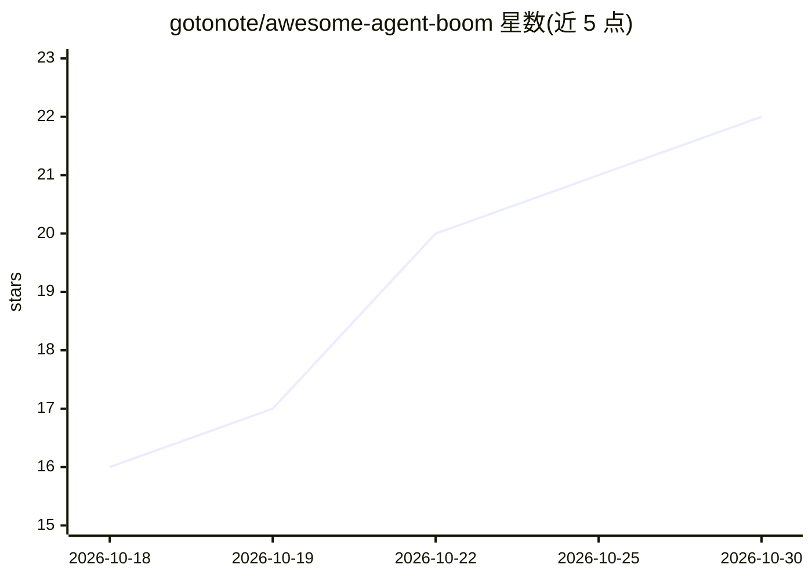

# gotonote/awesome-agent-boom

⭐ 22 · Python · MIT · 推送 2026-10-29 · [GitHub](https://github.com/gotonote/awesome-agent-boom) · [官网](https://gotonote.github.io/awesome-agent-boom/) · 个人维护 · 中文 README

**AI Agent 开源书单与课程合集，Star 数每日自动更新**

GitHub 上 AI Agent / LLM Agent 相关开源书籍、课程与配套代码仓库的策展清单，按中文开源图书、英文图书课程、商业书配套代码、论文清单、Agent 规则书、AI 写书实验、Agent Harness 生态、Agent 框架八类组织，并附入门/进阶/面试/实践推荐阅读路线。条目含 Star 数与难度标注（入门/进阶/深度），Star 数由 GitHub Actions 每日自动更新，接受 Issue 与 PR 共建。

## 筛选速览

| 维度 | 判定 | 备注 |
|---|---|---|
| AI 角色 | `ai-knowledge` | 知识聚合/清单类 |
| 许可风险 | `permissive` | MIT |
| 部署形态 | `None` |  |
| 模型依赖 | — | README 未给出锁定关系 |
| 硬件要求 | — | 无带数字的原话,不猜 |
| 安装摩擦 | `low` | 无编译、无系统依赖或容器化 |
| 成熟度 | — | 结构信号不足 |

## 能力要点

- 八个类别收录开源图书、课程、论文清单与 Agent 框架仓库
- Star 数由 GitHub Actions 每日自动更新，按热门度排序
- 提供入门、进阶、面试、动手实践四条推荐阅读路线

## 适用场景

- 寻找 AI Agent 入门与进阶的学习书籍和课程
- 了解 Agent Harness 生态与主流 Agent 框架项目
- 查找 LLM Agent 论文清单与面试准备资源

## 场景标签

`精选清单` `教程课程` · 领域:学习与行业

## 证据(README 行号)

> L3: **🚀 AI Agent 学习宝典** · GitHub 上最热门的 AI Agent / LLM Agent 开源书籍、课程与配套代码仓库精选，Star 数每日自动更新。
> L16: ## 📑 目录
> L18: - 📰 黑板报：进入黑板报

## 星数曲线

2026-10-18 16 → 2026-10-30 22（+6）

---
*卡片 v1 · prompt 1.4 · 生成 2026-10-28 · 置信度 high · 依据 README sha `76077ed9174a` · [字段定义](../../DATASET.md)*
