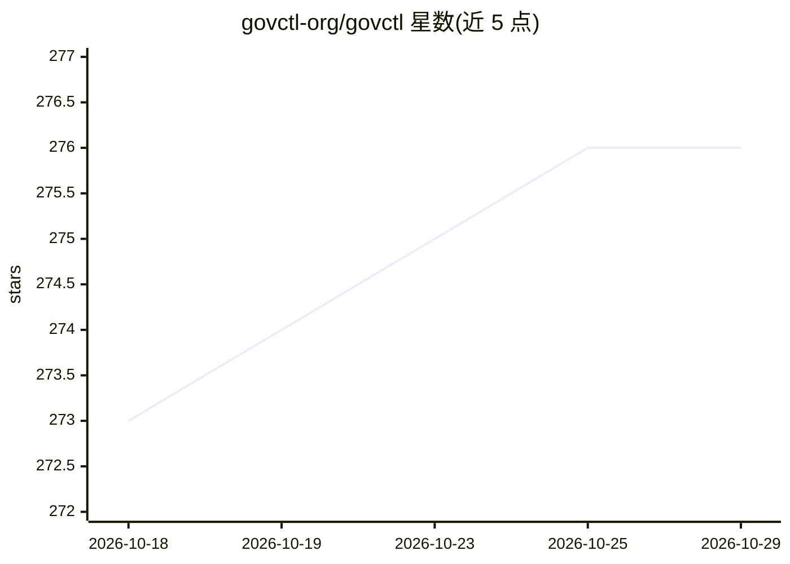

# govctl-org/govctl

⭐ 276 · Rust · MIT · 推送 2026-10-18 · [GitHub](https://github.com/govctl-org/govctl) · [官网](https://govctl-org.github.io/govctl/) · 组织维护

**面向 AI 编码团队的治理即代码 CLI：把提示与补丁纳入 RFC/ADR/工作项管控**

govctl 是 Rust 编写的治理即代码命令行工具，为使用 AI agent（Claude Code、Codex、Cursor 等）构建软件的团队提供仓库内控制平面：RFC 声明约束、ADR 记录设计决策、工作项跟踪执行与验收标准、验证守卫（guards）在完成门禁执行可执行检查，Conformance Cases 建立从 RFC 条款到场景与守卫的追溯链接。制品以 TOML 文件存于 gov/ 目录，可通过 CLI 精确读写与全文搜索，附只读 TUI 驾驶舱。支持存量仓库渐进迁移（/migrate）与制品格式升级，通过 cargo install 安装并为 Claude/Codex 提供捆绑集成。

## 筛选速览

| 维度 | 判定 | 备注 |
|---|---|---|
| AI 角色 | `ai-ecosystem` | LLM/agent 周边工具 |
| 许可风险 | `permissive` | MIT |
| 部署形态 | `library` | 以包/库形式分发 |
| 模型依赖 | locked-api |  |
| 硬件要求 | — | 无带数字的原话,不猜 |
| 安装摩擦 | `low` | 无编译、无系统依赖或容器化 |
| 成熟度 | — | 结构信号不足 |

## 能力要点

- RFC/ADR/工作项/守卫的 TOML 制品与稳定 CLI 契约
- 验证守卫在完成门禁执行可执行检查，可豁免并要求记录理由
- Conformance Cases 将验收场景映射到版本化 RFC 条款与守卫
- 为 Claude Code 与 Codex 提供原生插件机制安装的 skills/hooks 集成

## 适用场景

- 团队用 Claude Code/Codex/Cursor 做正式产品开发时保持变更可评审、可追溯
- 把散落在聊天记录里的设计决策固化为仓库内 ADR/RFC 制品
- 在存量仓库中渐进引入治理而不重写项目
- 通过完成门禁守卫定义工作何时算真正完成

## 场景标签

 · 领域:软件开发治理/AI 编码工具

## 证据(README 行号)

> L17: `govctl` is a governance-as-code CLI for teams using AI to build software seriously.
> L19: It gives AI-assisted development a control plane that lives in your repo:
> L75: ### 3. One CLI agents can reliably operate

## 星数曲线

2026-10-18 273 → 2026-10-29 276（+3）

---
*卡片 v1 · prompt 1.4 · 生成 2026-10-22 · 置信度 high · 依据 README sha `8284ca81f19d` · [字段定义](../../DATASET.md)*
