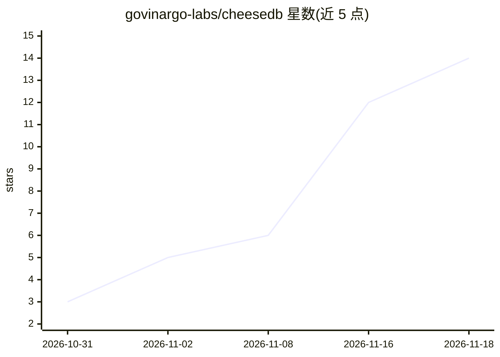

# govinargo-labs/cheesedb

⭐ 14 · Go · Apache-2.0 · 推送 2026-11-16 · [GitHub](https://github.com/govinargo-labs/cheesedb) · [官网](https://cheesedb.dev) · 组织维护

**面向 AI 记忆的嵌入式 Go 数据库：溯源、可撤销、哈希链**

用 Go 标准库编写的嵌入式、append-only、哈希链记忆数据库，供 AI agent 使用。每条记忆必须记录来源；一次 recall 调用即可移除某来源及其派生的全部记忆（Fair/Strict 两种策略），Erase 模式在返回前从磁盘文件中移除文本。支持通过自选嵌入模型做语义 search/ask/forget，也提供 cheesedb 命令与 MCP server，可从 Claude Code、Cursor 等 MCP 应用调用。无模型时其余功能照常工作。状态为 preview：未做独立安全审查，v1.0 前 API 与磁盘格式可能变化，不建议用于生产数据。Windows 暂不支持。

## 筛选速览

| 维度 | 判定 | 备注 |
|---|---|---|
| AI 角色 | `ai-ecosystem` | LLM/agent 周边工具 |
| 许可风险 | `permissive` | Apache-2.0 |
| 部署形态 | `library` | 以包/库形式分发 |
| 模型依赖 | local-ok | 支持本地模型 |
| 硬件要求 | — | 无带数字的原话,不猜 |
| 安装摩擦 | `low` | 无编译、无系统依赖或容器化 |
| 成熟度 | `idea` | |

## 能力要点

- 每条记忆强制记录来源，recall 按依赖链级联移除（Fair/Strict 两种策略）
- Erase 模式在返回前从磁盘文件移除文本，且哈希链仍可验证
- 每 agent 独立 token 隔离，防止提示注入跨 agent 访问
- 提供 Go 库、cheesedb 命令与 MCP server，兼容任意 OpenAI 兼容嵌入服务

## 适用场景

- AI agent 记忆中某个来源被证伪或需删除时，连带清除所有派生记忆
- 满足用户数据删除请求（从磁盘真正抹除文本与向量）
- 通过 MCP 应用（Claude Code、Cursor 等）管理 agent 的长期记忆
- 检测记忆文件是否被静默篡改（打开时校验哈希链）

## 场景标签

`Agent 记忆` · 领域:Agent 开发

## 证据(README 行号)

> L10: An embedded, append-only, hash-chained memory database for AI agents, written in Go with the standard library only.
> L29: - **Every memory records its sources.** A memory is stored with the sources (or other memories) it was learned from
> L125: **Set it up** by adding an embedding model to `~/.cheesedb/llm.conf`. Any OpenAI-compatible server works (Ollama, 

## 星数曲线

2026-10-31 3 → 2026-11-18 14（+11）

---
*卡片 v1 · prompt 1.4 · 生成 2026-11-18 · 置信度 high · 依据 README sha `54141d0f1106` · [字段定义](../../DATASET.md)*
