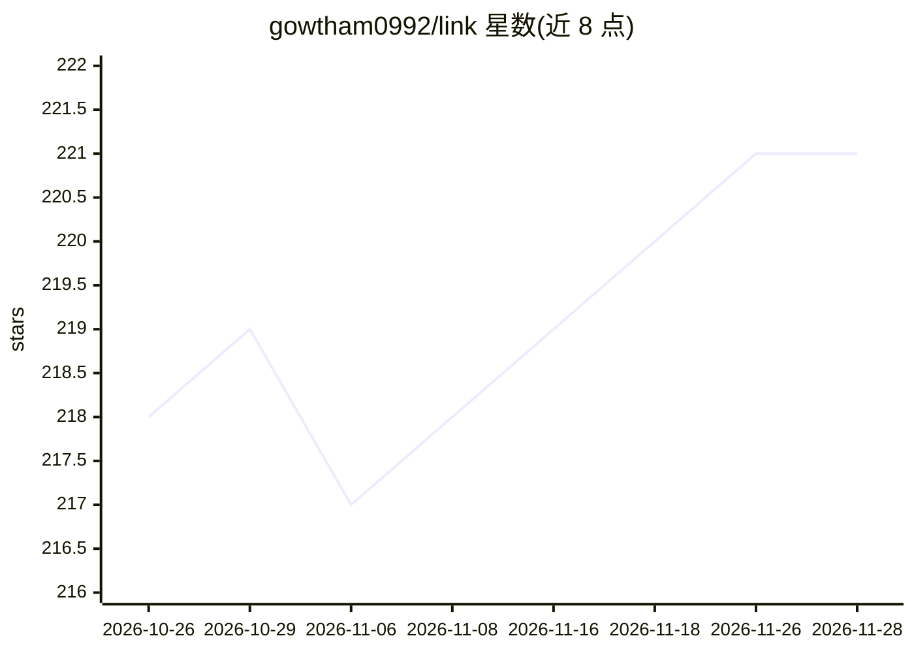

# gowtham0992/link

⭐ 221 · Python · MIT · 推送 2026-11-27 · [GitHub](https://github.com/gowtham0992/link) · [官网](https://gowtham0992.github.io/link/) · 个人维护

**给本地 AI agent 提供基于 Markdown 的本地持久记忆层**

Link 是面向本地 AI agent 的开源记忆层：把原始来源整理为可检视的 Markdown wiki，将用户明确要求记住的偏好、决策与项目上下文存为可审核的记忆，agent 通过 CLI、MCP、官方技能或本地查看器检索带出处的紧凑上下文。通过 hook 与规则文件接入 Claude Code、Cursor、Codex 等十余种 agent，写入需用户批准；记忆层本身不含 LLM，保存、去重、矛盾检查与召回均为确定性操作，并提供规则阻断、过期检查与 session receipt 机制。

## 筛选速览

| 维度 | 判定 | 备注 |
|---|---|---|
| AI 角色 | `ai-ecosystem` | LLM/agent 周边工具 |
| 许可风险 | `permissive` | MIT |
| 部署形态 | `library` | 以包/库形式分发 |
| 模型依赖 | — | README 未给出锁定关系 |
| 硬件要求 | — | 无带数字的原话,不猜 |
| 安装摩擦 | `low` | 无编译、无系统依赖或容器化 |
| 成熟度 | — | 结构信号不足 |

## 能力要点

- 记忆以纯 Markdown 文件存储，可 grep、git-diff、跨多个 agent 共享
- review-gated 写入：agent 只能提议，用户批准后才落盘
- 记忆层无 LLM，写入路径确定性运行
- 记忆可携带规则，在工具调用前执行检查（约 0.2ms/次）

## 适用场景

- 让多个 agent 共享同一份已审核的个人偏好与项目决策
- 避免每个新会话重复解释项目上下文
- 在 agent 执行敏感命令前插入用户确认规则
- 以本地纯文件方式保存私有记忆

## 场景标签

`Agent 记忆` · 领域:Agent 开发

## 证据(README 行号)

> L5:  Local memory for AI agents.
> L89: Link is an open-source memory layer for local AI agents. Raw sources become an
> L91: memories. Agents retrieve compact, source-backed context through the CLI, MCP,

## 星数曲线

2026-10-26 218 → 2026-11-28 221（+3）

---
*卡片 v1 · prompt 1.4 · 生成 2026-11-26 · 置信度 high · 依据 README sha `187457d56545` · [字段定义](../../DATASET.md)*
