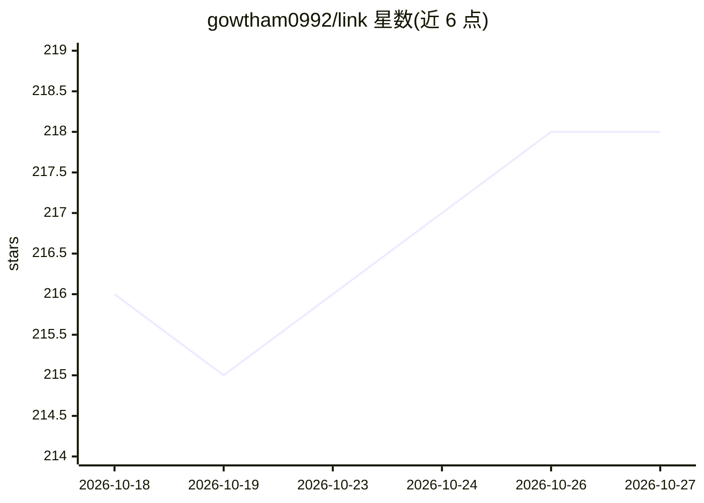

# gowtham0992/link

⭐ 218 · Python · MIT · 推送 2026-10-26 · [GitHub](https://github.com/gowtham0992/link) · [官网](https://gowtham0992.github.io/link/) · 个人维护

**面向本地 AI agent 的跨工具本地记忆层，以 Markdown 存储**

Link 是开源的本地 agent 记忆层：为 Codex、Claude Code、Cursor、VS Code、Copilot 等本地 agent 提供共享的来源可溯记忆，存储为本地 Markdown wiki。机制包括：捕获原始材料生成带来源的 wiki 页面、review-gated 写入（agent 提议、用户批准）、记忆层无 LLM（摄入与召回为确定性流程）、经 git remote 由用户控制的同步。通过 CLI（lnk）、MCP、skills 与本地 web viewer 检索紧凑上下文包。Web viewer 仅绑定 127.0.0.1、无认证，不应暴露公网。

## 筛选速览

| 维度 | 判定 | 备注 |
|---|---|---|
| AI 角色 | `ai-ecosystem` | LLM/agent 周边工具 |
| 许可风险 | `permissive` | MIT |
| 部署形态 | `library` | 以包/库形式分发 |
| 模型依赖 | — | README 未给出锁定关系 |
| 硬件要求 | — | 无带数字的原话,不猜 |
| 安装摩擦 | `low` | 无编译、无系统依赖或容器化 |
| 成熟度 | — | 结构信号不足 |

## 能力要点

- 记忆以纯 Markdown 文件存储，可 grep/git-diff
- review-gated 写入：agent 提议、用户批准
- 记忆层无 LLM，摄入与召回确定性执行
- 一条命令（lnk setup）为多个已安装 agent 配置 MCP 与 hooks

## 适用场景

- 让多个 AI 编码 agent 共享同一份本地记忆与偏好
- 把分散在各工具的记忆导入并审阅后合并
- 以 git 远端在多机或团队间同步已审记忆

## 场景标签

`Agent 记忆` `知识库管理` · 领域:Agent 开发

## 证据(README 行号)

> L52: Link is an open-source memory layer for local AI agents. Raw sources become an
> L73: 4. **Retrieve** compact query packets through the CLI, MCP, official skills, or the local web viewer.

## 星数曲线

2026-10-18 216 → 2026-10-27 218（+2）

---
*卡片 v1 · prompt 1.4 · 生成 2026-10-22 · 置信度 high · 依据 README sha `2e21c14eafcc` · [字段定义](../../DATASET.md)*
