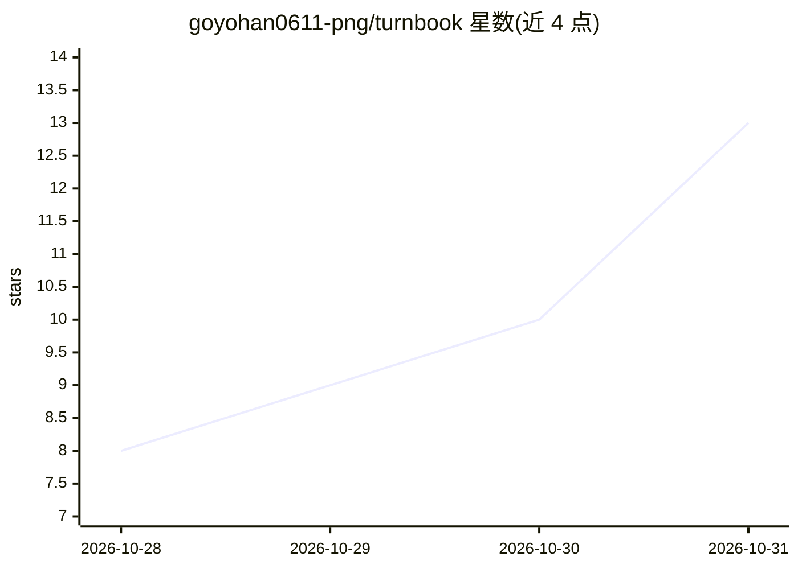

# goyohan0611-png/turnbook

⭐ 13 · Python · Apache-2.0 · 推送 2026-10-30 · [GitHub](https://github.com/goyohan0611-png/turnbook) · 个人维护 · 中文 README

**本地长期记忆层：让多个 AI 编码代理共享逐字对话记忆**

面向 Claude Code、Codex、Cursor、Copilot CLI、Gemini CLI 等编码代理的本地长期记忆服务：逐字保存每一轮对话到单个 SQLite 文件，保存时不调用 LLM、零 token 消耗；回答前通过本地检索（词搜索＋本地 EmbeddingGemma 嵌入＋时间）把相关轮次注入消息，经 MCP 提供工具。数据留在本机，无账号无云端，支持跨机共享、文档导入、导出导入与团队共享。LongMemEval 得分 91.8%。

## 筛选速览

| 维度 | 判定 | 备注 |
|---|---|---|
| AI 角色 | `ai-ecosystem` | LLM/agent 周边工具 |
| 许可风险 | `permissive` | Apache-2.0 |
| 部署形态 | `library` | 以包/库形式分发 |
| 模型依赖 | — | README 未给出锁定关系 |
| 硬件要求 | — | 无带数字的原话,不猜 |
| 安装摩擦 | `low` | 无编译、无系统依赖或容器化 |
| 成熟度 | `idea` | |

## 能力要点

- 逐字保存对话，写入时不调用 LLM，零保存 token
- 单个 SQLite 文件存储，本地搜索（词＋嵌入＋时间＋学习重排序）
- Claude Code/Codex/Cursor/Copilot CLI/Gemini CLI/OpenCode 等共用同一记忆
- 支持文档检索、跨 PC 加密共享、导出/导入、团队共享项目记忆

## 适用场景

- 在不同 AI 编码代理间共享历史决策与上下文
- 新会话中让代理回忆昨天/上周的决定与改动
- 把项目 Markdown 文档与对话一起检索
- 团队共享项目决策记录而不共享个人记忆

## 场景标签

`Agent 记忆` · 领域:Agent 开发

## 证据(README 行号)

> L7: **No AI summaries: every conversation is kept word for word, so nothing is lost or made up on the way in, and saving
> L93: - **Free to save, on your PC.** Every turn is stored word for word in one SQLite file: no model

## 星数曲线

2026-10-28 8 → 2026-10-31 13（+5）

---
*卡片 v1 · prompt 1.4 · 生成 2026-10-31 · 置信度 high · 依据 README sha `82b0b80d0eee` · [字段定义](../../DATASET.md)*
