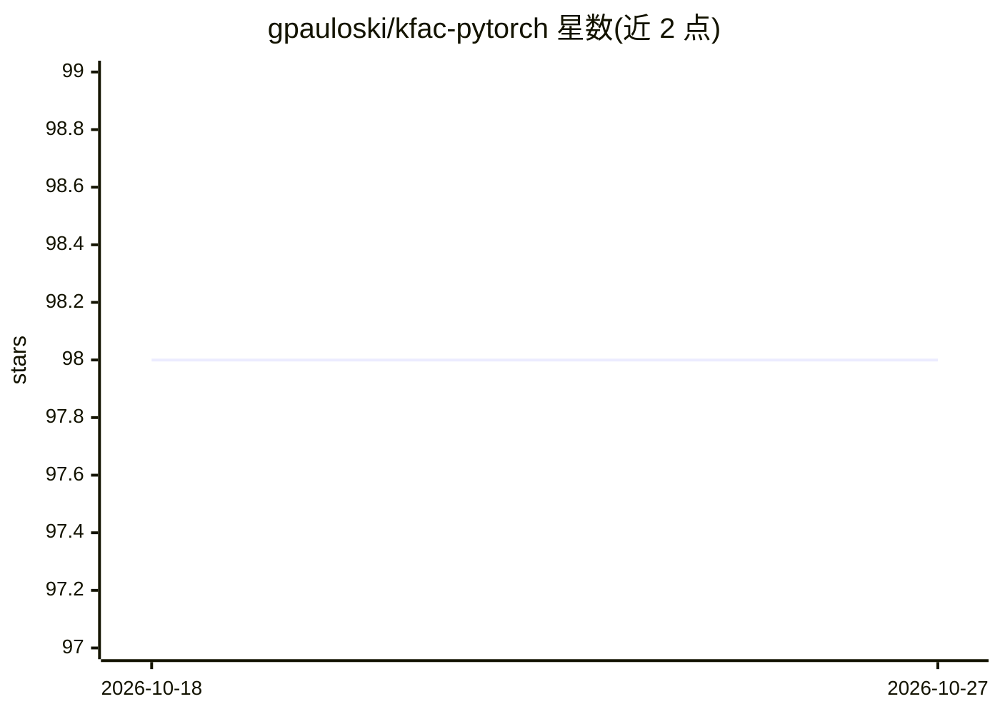

# gpauloski/kfac-pytorch

⭐ 98 · Python · MIT · 推送 2026-10-20 · [GitHub](https://github.com/gpauloski/kfac-pytorch) · 个人维护

**面向 PyTorch 的分布式 K-FAC 二阶预条件器库**

提供 K-FAC（Kronecker 分解的 Fisher 信息矩阵近似）在 PyTorch 中的实现，作为标准 PyTorch 优化器的预条件器，支持单设备与分布式训练。分布式策略基于 KAISA 框架，通过 gradient worker fraction 参数控制二阶计算与梯度预条件化的放置位置。仅需 PyTorch 1.8+，另提供 Cifar10 与 ImageNet-1k 上的 ResNet 训练示例脚本。面向深度学习训练开发者，附多篇 SC/TPDS 论文。

## 筛选速览

| 维度 | 判定 | 备注 |
|---|---|---|
| AI 角色 | `ai-ecosystem` | LLM/agent 周边工具 |
| 许可风险 | `permissive` | MIT |
| 部署形态 | `library` | 以包/库形式分发 |
| 模型依赖 | — | README 未给出锁定关系 |
| 硬件要求 | — | 无带数字的原话,不猜 |
| 安装摩擦 | `low` | 无编译、无系统依赖或容器化 |
| 成熟度 | — | 结构信号不足 |

## 能力要点

- K-FAC 作为标准 PyTorch 优化器的预条件器
- 支持单设备与分布式训练（基于 KAISA 策略）
- 通过 gradient worker fraction 参数控制计算放置
- 提供 Cifar10/ImageNet-1k 的 ResNet 训练示例脚本

## 适用场景

- 在分布式训练中用二阶优化方法加速收敛
- 为已有 PyTorch 训练脚本以少量代码接入 K-FAC
- 复现 ResNet-50 等 K-FAC 训练实验

## 场景标签

`模型训练` · 领域:训练与推理

## 证据(README 行号)

> L9: This repository provides a PyTorch implementation of K-FAC as a preconditioner to standard PyTorch optimizers with s
> L10: The distributed strategy is implemented using KAISA, a K-FAC-enabled, Adaptable, Improved, and Scalable second-orde

## 星数曲线

2026-10-18 98 → 2026-10-27 98（+0）

---
*卡片 v1 · prompt 1.4 · 生成 2026-10-23 · 置信度 mid · 依据 README sha `6388df061548` · [字段定义](../../DATASET.md)*
