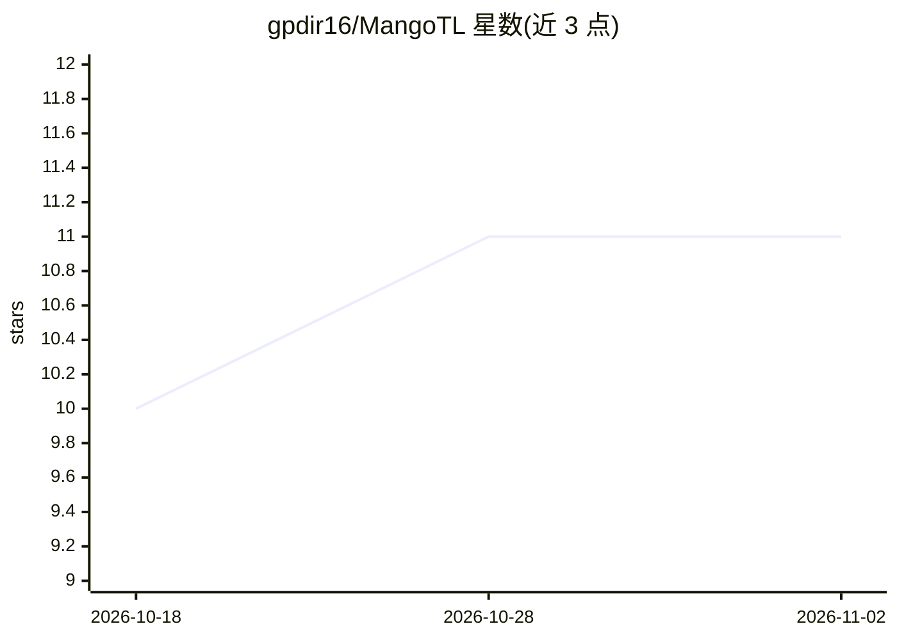

# gpdir16/MangoTL

⭐ 11 · JavaScript · AGPL-3.0 · 推送 2026-10-05 · [GitHub](https://github.com/gpdir16/MangoTL) · 个人维护

**浏览器内翻译漫画/webtoon 图片的 AI 扩展与自托管服务**

MangoTL 由浏览器扩展与自托管服务器两部分组成：服务器接收图片，经 PaddleOCR 检测文字，再调用所选 AI 提供商（OpenRouter、OpenAI、Ollama 本地/云、Upstage 等）生成译文，浏览器扩展在 Pixiv.net 与 X.com 页面上直接翻译图片。支持日/韩/英/中/德/瑞典语互译。服务器可用 Docker 镜像或 Bun/NodeJS 源码运行，扩展从 Firefox Add-ons 安装或本地构建临时加载；需在 localhost:8787/config 配置提供商、API key 与模型。采用 AGPL-3.0-or-later 许可。

## 筛选速览

| 维度 | 判定 | 备注 |
|---|---|---|
| AI 角色 | `ai-native` | 本体是模型或模型工具 |
| 许可风险 | `viral` | AGPL-3.0 |
| 部署形态 | `self-host` | docker 或自建部署 |
| 模型依赖 | local-ok | 支持本地模型 |
| 硬件要求 | — | 无带数字的原话,不猜 |
| 安装摩擦 | `low` | 无编译、无系统依赖或容器化 |
| 成熟度 | — | 结构信号不足 |

## 能力要点

- 浏览器扩展 + 自托管服务器架构，图片直接翻译
- PaddleOCR 文字检测 + 多 AI 提供商（含本地 Ollama）
- 支持 Pixiv.net 与 X.com，六种源/目标语言
- 服务器提供 GHCR Docker 镜像与源码两种运行方式

## 适用场景

- 在 Pixiv/X 上浏览漫画时直接翻译图中文字
- 用本地 Ollama 模型离线/私有化翻译漫画图片
- 自托管翻译服务供自己的浏览器扩展调用

## 场景标签

`OCR` · 领域:感知与多模态

## 证据(README 行号)

> L5: MangoTL is an AI-powered translation browser extension and self-hostable server for comics, manga, and webtoons.
> L53: ### Detection/OCR Engines

## 星数曲线

2026-10-18 10 → 2026-11-02 11（+1）

---
*卡片 v1 · prompt 1.4 · 生成 2026-11-02 · 置信度 high · 依据 README sha `a36fe41ab5cf` · [字段定义](../../DATASET.md)*
