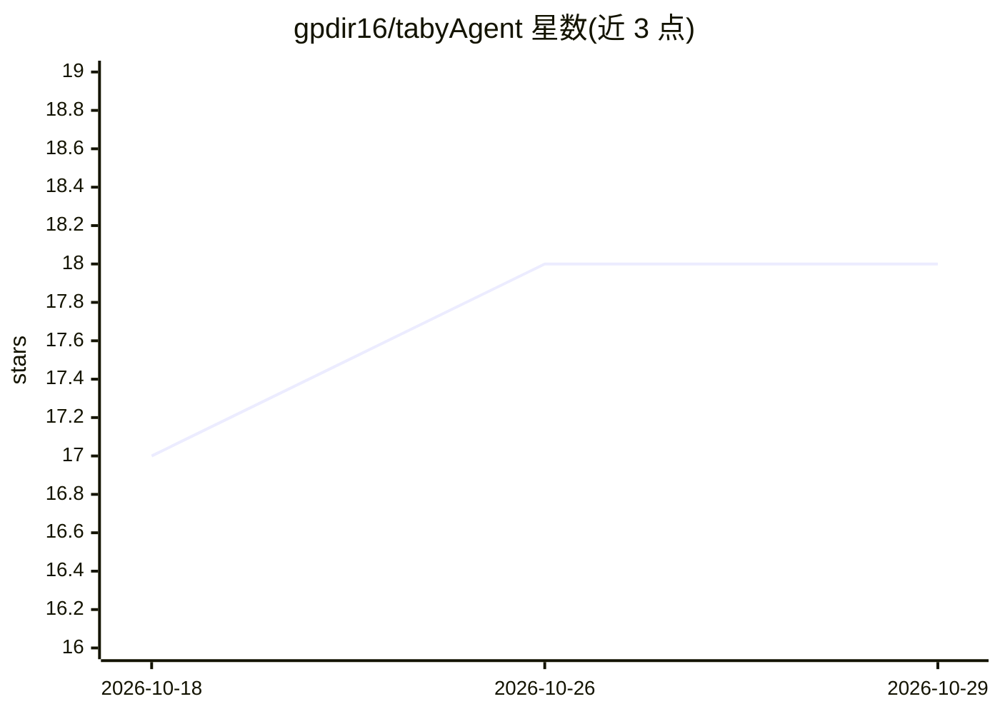

# gpdir16/tabyAgent

⭐ 18 · JavaScript · AGPL-3.0 · 推送 2026-10-16 · [GitHub](https://github.com/gpdir16/tabyAgent) · 个人维护 · 中文 README

**Telegram 自治 AI agent：长期执行任务、记忆与定时作业开箱即用**

运行在 Telegram 上的个人 AI agent。用户下达任务后由 agent 长时间自主执行，功能包括持久记忆、技能与 MCP 工具（可自行发现安装）、定时任务、共享待办、网页浏览、GUI 应用操作、自我改进与多 agent 协作；另含加密密码库与按日/按模型的 token 用量统计。推理后端可接 OpenAI、Claude、Grok、Ollama（本地与云）、OpenRouter 等多种 provider。安装提供脚本（Docker 或本地 Node.js 22+，macOS/Linux 原生，Windows 仅经 Docker）或 Docker Compose。作者提示同作者的 tabyBot 功能更新，建议新用户从 tabyBot 开始。

## 筛选速览

| 维度 | 判定 | 备注 |
|---|---|---|
| AI 角色 | `ai-native` | 本体是模型或模型工具 |
| 许可风险 | `viral` | AGPL-3.0 |
| 部署形态 | `self-host` | docker 或自建部署 |
| 模型依赖 | local-ok | 支持本地模型 |
| 硬件要求 | — | 无带数字的原话,不猜 |
| 安装摩擦 | `low` | 无编译、无系统依赖或容器化 |
| 成熟度 | — | 结构信号不足 |

## 能力要点

- 任务级自治执行：可长时运行并处理故障后继续
- 多推理后端接入（OpenAI/Claude/Grok OAuth/Ollama 本地与云/OpenRouter 等）
- 多 agent、定时任务、共享待办、记忆与自我改进开箱即用
- 支持 Docker 容器或本地 Node.js 运行，附带安装脚本与 tabyagent 管理命令

## 适用场景

- 通过 Telegram 让 agent 代为处理长耗时任务（整理文件、汇总账单等）
- 设置每日定时任务（早八点天气与待办推送）
- 创建不同角色的专家 agent 协作处理事项
- 让 agent 记住常用信息并提醒遗忘事项

## 场景标签

`AI 助手` `多智能体` · 领域:Agent 开发

## 证据(README 行号)

> L7: Give it a task and it will do it, even if it takes hours or things go wrong.
> L13: - **Everyday chat**: Get answers in Telegram. Almost every format is supported — text, images, files, and more.
> L14: - **Inference providers**: Connect OpenAI, OpenRouter, Upstage, OrcaRouter, Synthetic, Ollama (local and Cloud), Ze

## 星数曲线

2026-10-18 17 → 2026-10-29 18（+1）

---
*卡片 v1 · prompt 1.4 · 生成 2026-10-29 · 置信度 high · 依据 README sha `35760e79f899` · [字段定义](../../DATASET.md)*
