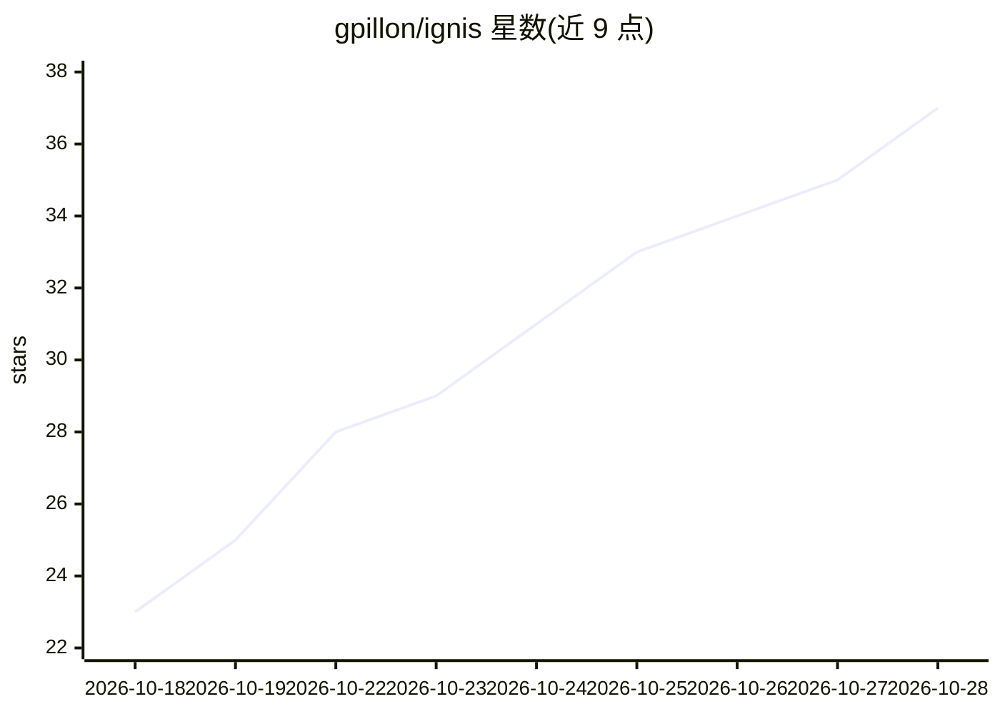

# gpillon/ignis

⭐ 43 · Rust · Apache-2.0 · 推送 2026-10-28 · [GitHub](https://github.com/gpillon/ignis) · 个人维护

**单卡 Blackwell GPU 上服务 Qwen3.8 与图像模型的 OpenAI 兼容推理服务器**

面向本地编码 agent 工作负载的推理服务器：在单张 RTX 5090 / RTX PRO 6000（SM120a）上加载 NVFP4 量化的 Qwen3.8-27B、125B Flash-Next MoE（trellis 码重量化）及 Qwen-Image-2.1-Turbo，通过 OpenAI v1 API 提供流式/非流式补全与图像生成/编辑。Rust 负责调度与 serving，前向计算在 C++/CUDA 库中；提供八条常驻解码 lane、字节预算的分页 KV、DFlash2 投机解码、Playground/Monitor/Prometheus。限制：仅支持一个模型家族与一类显卡；图像模型权重限非商业使用；16 GB 卡版本据 README 尚未实际运行过。提供 Windows/Linux 预编译包与容器镜像。

## 筛选速览

| 维度 | 判定 | 备注 |
|---|---|---|
| AI 角色 | `ai-ecosystem` | LLM/agent 周边工具 |
| 许可风险 | `permissive` | Apache-2.0 |
| 部署形态 | `None` |  |
| 模型依赖 | — | README 未给出锁定关系 |
| 硬件要求 | — | 无带数字的原话,不猜 |
| 安装摩擦 | `high` | 编译与系统依赖俱全 |
| 成熟度 | — | 结构信号不足 |

## 能力要点

- 在单张 RTX 5090 上服务 Qwen3.8-27B（单 lane 约 167-491 tok/s）与 125B Flash-Next MoE
- OpenAI v1 兼容 API，内置 Playground、Monitor 与 Prometheus 指标
- hq-e8-2b KV 格式使 KV 容量为 BF16 的 7.11 倍，支持最长 896K 上下文
- Qwen-Image-2.1-Turbo 图像生成/编辑（2048² 图约 7.9 秒），模型间免重启切换

## 适用场景

- 本地跑编码 agent（主 agent 加多个子 agent 共用一张卡）
- 用 OpenAI 兼容客户端接入本地 Qwen3.8 模型推理
- 单张 5090/RTX PRO 6000 上同时获得文本与图像生成能力

## 场景标签

`推理引擎` `图像生成` · 领域:内容生成

## 证据(README 行号)

> L5:  A single-GPU inference engine for Qwen3.8 (the 27B and the 125B Flash-Next MoE) and Qwen-Image-2.1, built for the l
> L45: completions over the OpenAI v1 API, and is shaped around the workload a
> L90: library behind a flat, device-resident step-level C ABI. The engine is its own

## 星数曲线

2026-10-18 23 → 2026-10-28 37（+14）

---
*卡片 v1 · prompt 1.4 · 生成 2026-10-25 · 置信度 high · 依据 README sha `616fc018b8e6` · [字段定义](../../DATASET.md)*
