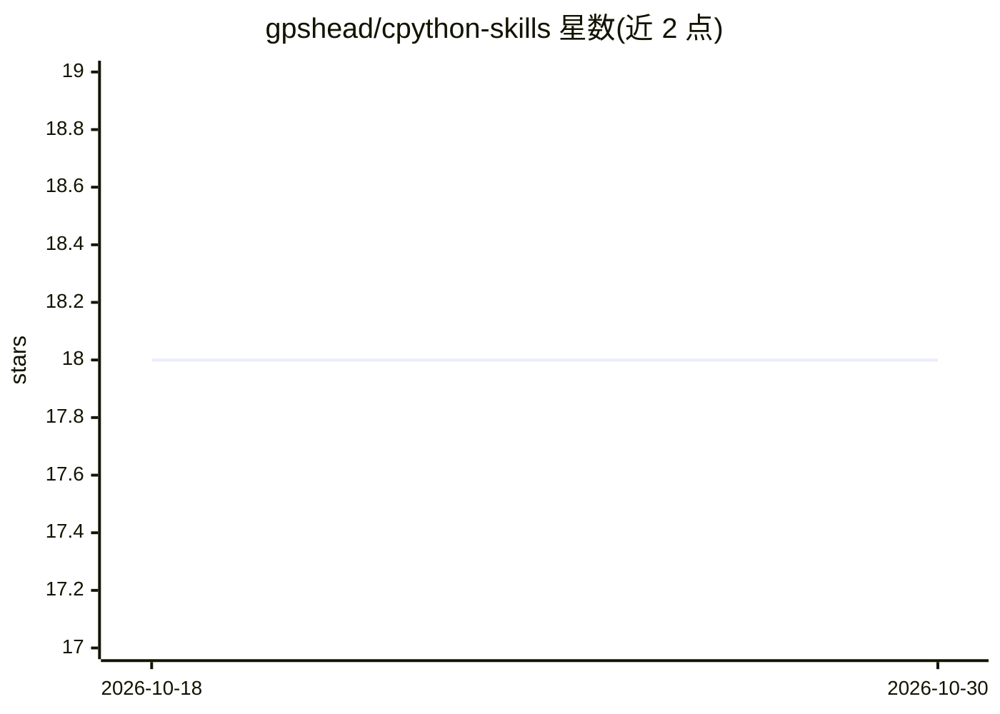

# gpshead/cpython-skills

⭐ 18 · CC0-1.0 · 推送 2026-10-22 · [GitHub](https://github.com/gpshead/cpython-skills) · 个人维护

**面向 CPython 仓库开发的 Claude Code 技能市场插件**

一个 Claude Code marketplace 仓库，提供一个名为 cpython 的插件，内含六个技能（dev/build/style/docs/backport/scan-triage）加一个协调加载的元技能，覆盖 CPython 的代码结构定位、编译与测试（unittest、--match 过滤）、PEP 7/8 提交规范、ReST 文档与 NEWS 条目、按 cherry_picker 约定做维护分支手工回移、以及把自动 bug 扫描结果整理为 issue 与草稿 PR。另含 /comments 命令审计注释，PreToolUse 钩子阻止使用系统 Python。以 CC0 许可发布。

## 筛选速览

| 维度 | 判定 | 备注 |
|---|---|---|
| AI 角色 | `ai-ecosystem` | LLM/agent 周边工具 |
| 许可风险 | `viral` | CC0-1.0 |
| 部署形态 | `None` |  |
| 模型依赖 | — | README 未给出锁定关系 |
| 硬件要求 | — | 无带数字的原话,不猜 |
| 安装摩擦 | `low` | 无编译、无系统依赖或容器化 |
| 成熟度 | — | 结构信号不足 |

## 能力要点

- 六技能+元技能：dev/build/style/docs/backport/scan-triage
- backport 技能按 cherry_picker 约定处理分支命名与冲突改写
- scan-triage 将扫描器发现以子代理并行分诊为 issue 与草稿 PR
- PreToolUse 钩子强制使用 build/python 而非系统 Python

## 适用场景

- 在 CPython 仓库中让 Claude Code 辅助修 bug、编译与跑测试
- 把合并的变更按机器人约定手工回移到维护分支
- 批量分诊自动扫描出的 bug 并生成 issue/草稿 PR

## 场景标签

`编码 Agent` · 领域:编码与开发

## 证据(README 行号)

> L3: A Claude Code marketplace providing specialized skills for working with the CPython repository - the reference imple
> L7: This marketplace hosts Claude Code plugins with AI-agent skills for CPython development. Includes one comprehensive 

## 星数曲线

2026-10-18 18 → 2026-10-30 18（+0）

---
*卡片 v1 · prompt 1.4 · 生成 2026-10-29 · 置信度 high · 依据 README sha `3ed21df9fa56` · [字段定义](../../DATASET.md)*
