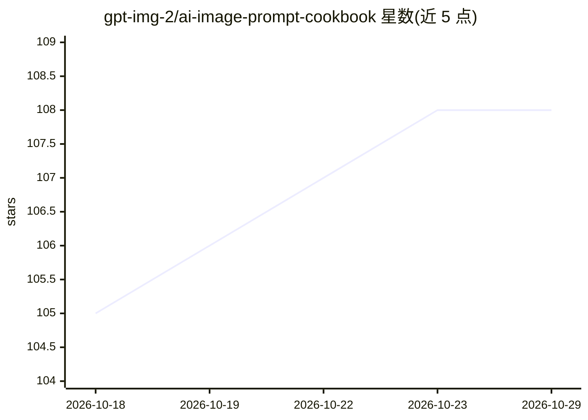

# gpt-img-2/ai-image-prompt-cookbook

⭐ 108 · NOASSERTION · 推送 2026-07-16 · [GitHub](https://github.com/gpt-img-2/ai-image-prompt-cookbook) · [官网](https://gptimg2.art/zh/prompts/gpt-image-2) · 个人维护 · 中文 README

**面向电商与内容创作的中文 AI 图片提示词模板库**

一个中文提示词精选库，覆盖 AI 女装（40 条）、童装（34 条）、电商主图、产品摄影、小红书封面与广告海报（各 10 条）等场景。条目以 Markdown 模板提供，用户复制后将方括号变量替换为自己的产品、场景、颜色等；另提供机器可读的 JSON 数据文件（提示词、分类、配图清单），并链接在线提示词库与生成器，附英/日/韩/西/越等语言入口。内容按 CC BY 4.0 发布。

## 筛选速览

| 维度 | 判定 | 备注 |
|---|---|---|
| AI 角色 | `ai-knowledge` | 知识聚合/清单类 |
| 许可风险 | `none` | NOASSERTION |
| 部署形态 | `None` |  |
| 模型依赖 | — | README 未给出锁定关系 |
| 硬件要求 | — | 无带数字的原话,不猜 |
| 安装摩擦 | `low` | 无编译、无系统依赖或容器化 |
| 成熟度 | — | 结构信号不足 |

## 能力要点

- 六类场景共 114 条中文提示词模板
- 提供 data/*.zh.json 机器可读数据文件
- 多语言入口按各语言用户习惯整理
- CC BY 4.0 许可支持二次分发

## 适用场景

- 做女装/童装电商图时直接套用提示词模板
- 生成小红书封面和广告海报配图
- 基于 JSON 数据文件做画廊或二次分发

## 场景标签

`提示工程` `精选清单` · 领域:Agent 开发

## 证据(README 行号)

> L3: 一个面向 AI 图片生成和图片编辑的中文提示词精选库，覆盖女装、童装、电商主图、产品摄影、小红书封面和广告海报等常见创作场景。
> L31: - AI 女装: 40 条

## 星数曲线

2026-10-18 105 → 2026-10-29 108（+3）

---
*卡片 v1 · prompt 1.4 · 生成 2026-10-23 · 置信度 mid · 依据 README sha `cf7425d29cf0` · [字段定义](../../DATASET.md)*
