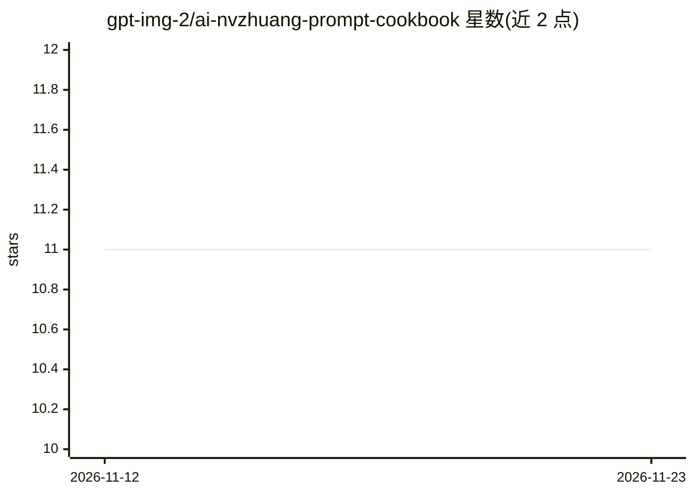

# gpt-img-2/ai-nvzhuang-prompt-cookbook

⭐ 11 · NOASSERTION · 推送 2026-06-07 · [GitHub](https://github.com/gpt-img-2/ai-nvzhuang-prompt-cookbook) · [官网](https://gptimg2.art/zh/prompts/gpt-image-2/category/womens-fashion?utm_source=github&utm_medium=repo&utm_campaign=fashion_prompt_cookbook&utm_content=womenswear) · 组织维护 · 中文 README

**女装电商与博主的 AI 图片生成提示词库**

按场景组织的 AI 女装图片提示词集合，覆盖女装店对镜自拍、淘宝/天猫/拼多多主图、小红书穿搭、连衣裙、韩系通勤、新中式等类别，提供面向 GPT Image 2 的提示词文本、可替换变量说明与避坑点，并附原始案例与效果图链接。以 Markdown 文档与中文 JSON 数据文件形式发布（CC BY 4.0），支持批量查找与二次开发；生成图片需通过外部在线生成器完成，仓库本身不含可执行代码。

## 筛选速览

| 维度 | 判定 | 备注 |
|---|---|---|
| AI 角色 | `ai-knowledge` | 知识聚合/清单类 |
| 许可风险 | `none` | NOASSERTION |
| 部署形态 | `None` |  |
| 模型依赖 | — | README 未给出锁定关系 |
| 硬件要求 | — | 无带数字的原话,不猜 |
| 安装摩擦 | `low` | 无编译、无系统依赖或容器化 |
| 成熟度 | — | 结构信号不足 |

## 能力要点

- 按 6+ 场景组织的女装提示词分类（自拍/主图/穿搭/连衣裙等）
- 每条提示词附适合场景、可替换变量与避坑点
- 提供全量中文 JSON 数据文件用于二次开发
- 按 CC BY 4.0 发布，附版权与安全使用说明

## 适用场景

- 给淘宝女装店批量生成上新主图
- 写小红书穿搭种草图文时套用现成提示词
- 把提示词数据接入自己的画廊或生成工具

## 场景标签

`提示工程` · 领域:Agent 开发

## 证据(README 行号)

> L3: 精选 AI 女装提示词，覆盖女装模特图、淘宝女装主图、小红书穿搭、女装店对镜自拍、韩系穿搭、连衣裙、通勤女装、新中式和 AI 换装。
> L43: |场景|适合用途|文件|
> L282: - `data/prompts.zh.json`: 全量中文提示词数据，适合二次开发或做自定义画廊。

## 星数曲线

2026-11-12 11 → 2026-11-23 11（+0）

---
*卡片 v1 · prompt 1.4 · 生成 2026-11-19 · 置信度 high · 依据 README sha `7081f98d7c90` · [字段定义](../../DATASET.md)*
