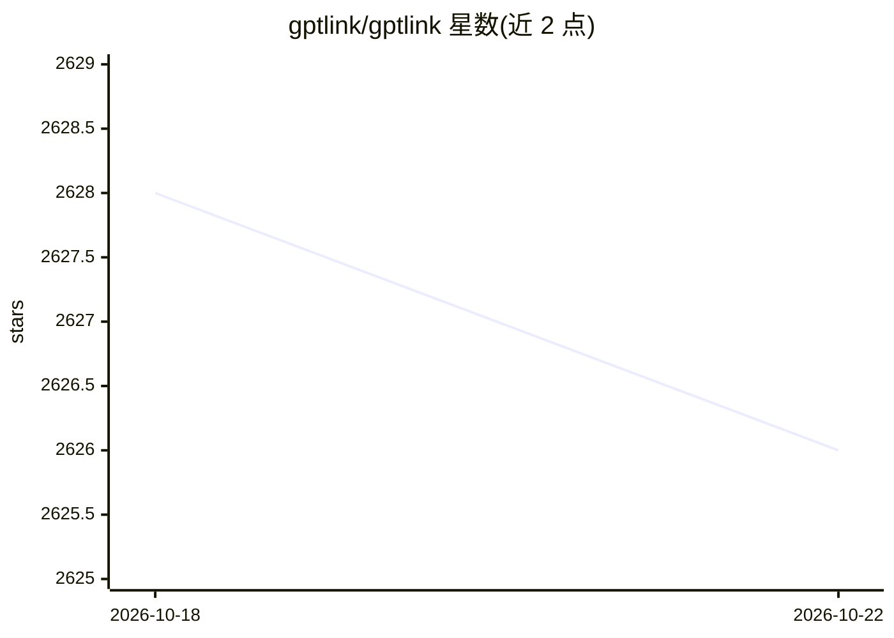

# gptlink/gptlink

⭐ 2,625 · PHP · 推送 2026-08-14 · [GitHub](https://github.com/gptlink/gptlink) · 组织维护 · 中文 README

**可自部署的 AI 对话站点程序，含用户/订单/付费功能**

基于 PHP (Hyperf) + Vue 的 AI 对话站点程序，供需要自建 AI 对话平台的用户部署：支持 Docker、Docker Compose 与 PHP 环境多种部署方式，内置控制台、移动端适配、自定义付费套餐、订单、任务拉新与对话导出。API Key 可使用 GPTLINK Key 或 OpenAI 官方 Key；微信相关应用（网站应用/公众号/微信支付）为非必须的可选配置。管理端源码尚未开源，AI 生图、分销、统计视图在版本计划中未完成。

## 筛选速览

| 维度 | 判定 | 备注 |
|---|---|---|
| AI 角色 | `ai-native` | 本体是模型或模型工具 |
| 许可风险 | `none` | — |
| 部署形态 | `self-host` | docker 或自建部署 |
| 模型依赖 | — | README 未给出锁定关系 |
| 硬件要求 | — | 无带数字的原话,不猜 |
| 安装摩擦 | `low` | 无编译、无系统依赖或容器化 |
| 成熟度 | — | 结构信号不足 |

## 能力要点

- 支持 Docker / Docker Compose / PHP 环境多种部署方式
- 内置用户、订单、付费套餐与任务拉新功能
- API Key 支持 GPTLINK Key 与 OpenAI 官方 Key
- 提供用户端与管理端 API 文档（/api/docs）

## 适用场景

- 快速搭建带付费功能的 AI 对话站点
- 通过任务拉新与自定义套餐运营对话服务
- 导出对话记录进行管理

## 场景标签

`聊天机器人` · 领域:对话与助手

## 证据(README 行号)

> L5:  只需简单几步，即可快速搭建可用的 AI对话 站点。
> L22: 1. 项目基于 PHP (Hyperf) + Vue 开发，推荐使用 Docker 进行部署；
> L25:  - OpenAi 官方 Key；

## 星数曲线

2026-10-18 2,628 → 2026-10-22 2,626（-2）

---
*卡片 v1 · prompt 1.4 · 生成 2026-10-21 · 置信度 high · 依据 README sha `e63977644533` · [字段定义](../../DATASET.md)*
