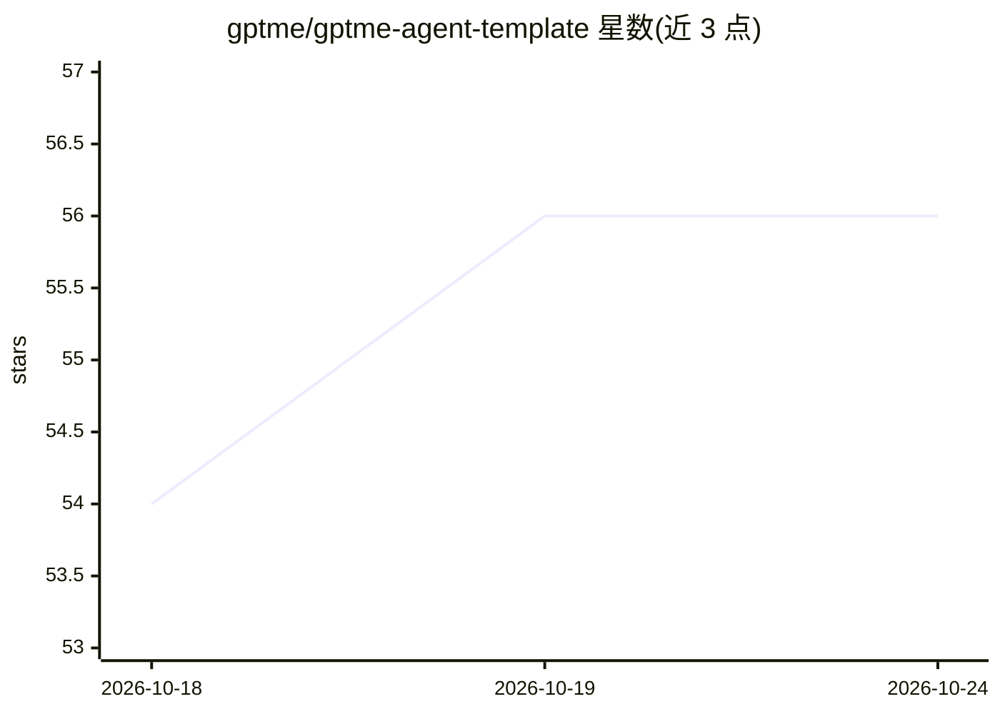

# gptme/gptme-agent-template

⭐ 57 · Shell · 推送 2026-10-21 · [GitHub](https://github.com/gptme/gptme-agent-template) · [官网](https://gptme.org) · 组织维护

**gptme 持久自治 agent 的 git 工作区模板**

基于 gptme 框架的 agent 工作区模板：以 git 仓库作为 agent 的身份、记忆、任务、日志与知识库载体，包含 TASKS.md、journal、lessons、双队列优先级系统与 CASCADE 工作流。原生支持 gptme 运行时，另提供 Claude Code 作为一等替代后端，Codex 需手动加载上下文，Grok Build/Pi 未接入。支持 systemd/launchd 定时自治运行，附 doctor 健康检查与 fork 脚本。面向希望搭建可长期运行自治 agent 的开发者。

## 筛选速览

| 维度 | 判定 | 备注 |
|---|---|---|
| AI 角色 | `ai-ecosystem` | LLM/agent 周边工具 |
| 许可风险 | `none` | — |
| 部署形态 | `library` | 以包/库形式分发 |
| 模型依赖 | — | README 未给出锁定关系 |
| 硬件要求 | — | 无带数字的原话,不猜 |
| 安装摩擦 | `low` | 无编译、无系统依赖或容器化 |
| 成熟度 | `idea` | |

## 能力要点

- git 仓库即 agent 大脑：身份（ABOUT.md/SOUL.md）、任务、日志、知识库集中管理
- 多运行时分层：gptme 原生、Claude Code 一等替代、Codex 手动兼容、Grok Build/Pi 未接入
- systemd/launchd 定时自治运行，含 GREEN/YELLOW/RED 安全分级
- gptme-agent doctor 工作区健康检查（--fix 自动修复）与 lessons 失败模式约束系统

## 适用场景

- 从模板 fork 出一个有独立身份和持久记忆的自治 agent
- 让 agent 按计划定时自动执行任务并管理工作队列
- 在 gptme 与 Claude Code 等不同运行时之间复用同一 agent 工作区

## 场景标签

`Agent 记忆` `Agent 框架` · 领域:Agent 开发

## 证据(README 行号)

> L8: > This is a template for a gptme-based agent. See the agents documentation for more information about gptme agents a
> L121: **Your agent is the workspace, not the harness.** Identity, memory, tasks,
> L130: |**Harness / runtime**|Agent loop, tools, context loading, permissions|gptme, Claude Code, Codex, Grok Build|

## 星数曲线

2026-10-18 54 → 2026-10-24 56（+2）

---
*卡片 v1 · prompt 1.4 · 生成 2026-10-24 · 置信度 mid · 依据 README sha `57d5c5e5f3ad` · [字段定义](../../DATASET.md)*
