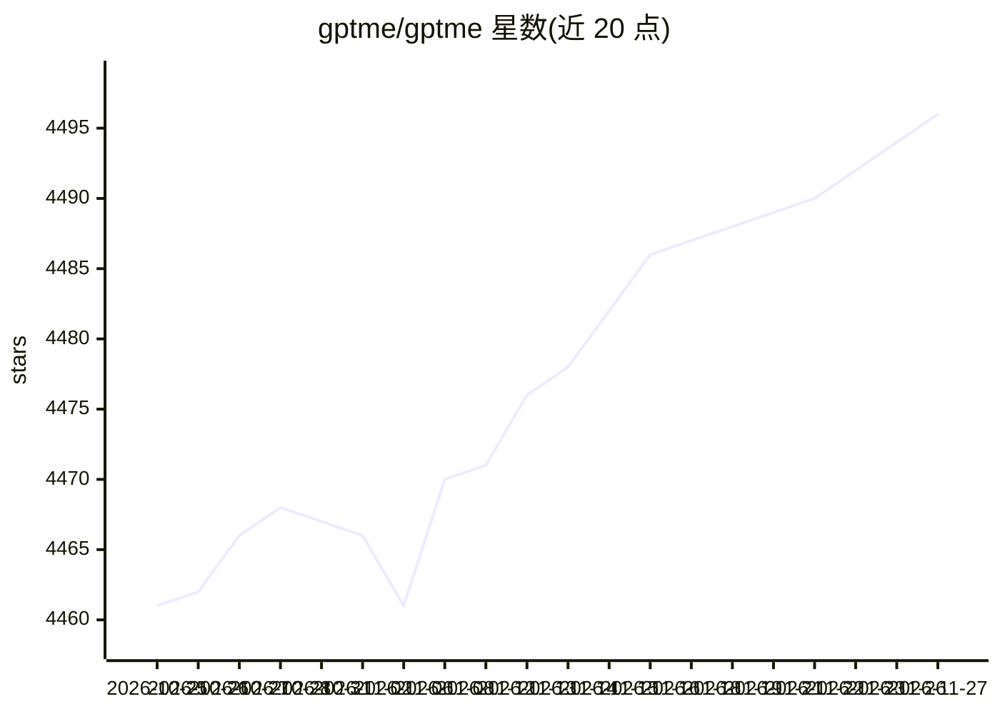

# gptme/gptme

⭐ 4,496 · Python · MIT · 推送 2026-11-26 · [GitHub](https://github.com/gptme/gptme) · [官网](https://gptme.org/) · 组织维护

**在终端中运行的本地工具 AI agent CLI**

在终端中运行的个人 AI agent CLI，可在笔记本、ssh、tmux、无头服务器和 CI 中使用，provider 无关且本地优先。内置 shell、Python、文件读写与 patch、浏览器（Playwright）、视觉、截图、tmux、GitHub、MCP 等约 20 个本地工具；支持插件、技能与 lessons 的分层扩展，可通过 gptme-agent-template 搭建持久自主 agent，或经 ACP 作为 Zed/JetBrains 的编码 agent。通过 PyPI/pipx 安装，另有 Linux/macOS/Windows 桌面应用与可自托管的 Web UI 及 REST API。

## 筛选速览

| 维度 | 判定 | 备注 |
|---|---|---|
| AI 角色 | `ai-native` | 本体是模型或模型工具 |
| 许可风险 | `permissive` | MIT |
| 部署形态 | `library` | 以包/库形式分发 |
| 模型依赖 | local-ok | 支持本地模型 |
| 硬件要求 | — | 无带数字的原话,不猜 |
| 安装摩擦 | `low` | 无编译、无系统依赖或容器化 |
| 成熟度 | `idea` | |

## 能力要点

- 内置约 20 个本地工具（shell/ipython/patch/browser/vision/tmux/computer 等）
- 支持插件、技能与 lessons 的分层扩展，及跨 harness 共享的本地 Markdown 记忆库
- 双向 MCP（客户端与服务端）与 ACP 集成，可作为 Zed/JetBrains 中的编码 agent
- 提供 gptme-agent-template 搭建持久自主 agent（git 追踪工作区、定时运行循环、多 agent 协调）

## 适用场景

- 在终端里让 agent 写代码、跑命令、改文件并自我纠错
- 把 agent 接入编辑器（Zed/JetBrains）或 Claude Desktop 等 MCP 客户端
- 用模板搭建持续运行的自主 agent 处理 GitHub、邮件等集成任务
- 通过 Ollama 或 OpenAI 兼容服务在本地运行 agent

## 场景标签

`AI 助手` `编码 Agent` · 领域:编码与开发

## 证据(README 行号)

> L49: 📜 A personal AI agent that runs anywhere a terminal runs — your laptop,
> L170: - 🤖 **Support for many LLM [providers][docs-providers]**

## 星数曲线

2026-10-25 4,461 → 2026-11-27 4,496（+35）

---
*卡片 v1 · prompt 1.4 · 生成 2026-11-24 · 置信度 high · 依据 README sha `9c8e23b39406` · [字段定义](../../DATASET.md)*
