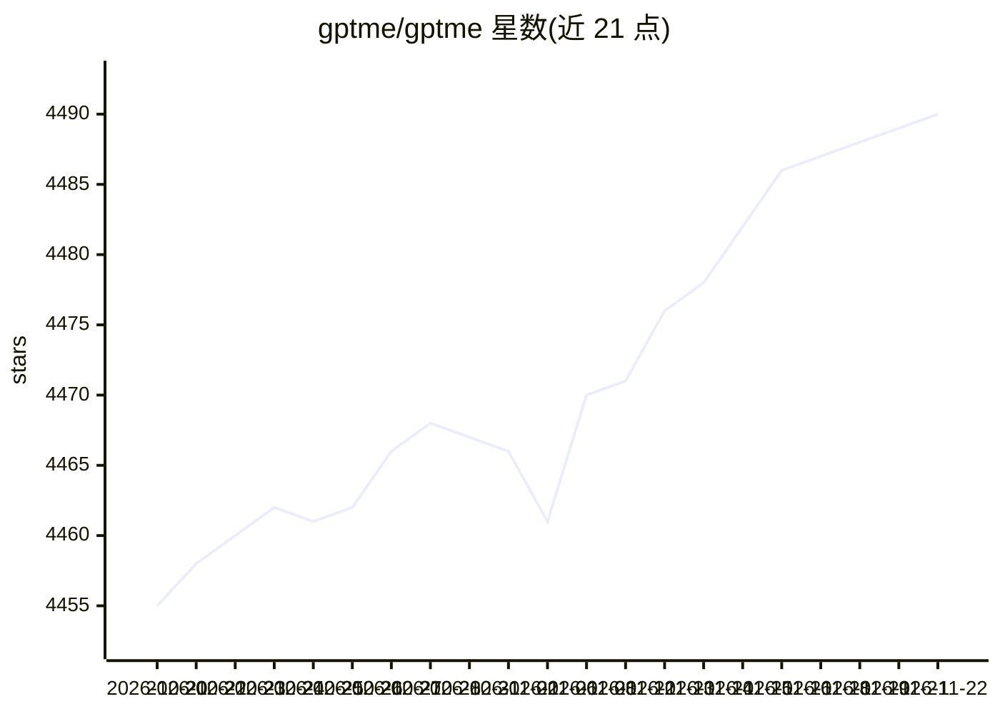

# gptme/gptme

⭐ 4,490 · Python · MIT · 推送 2026-11-21 · [GitHub](https://github.com/gptme/gptme) · [官网](https://gptme.org/) · 组织维护

**在终端运行的个人 AI agent：写代码、执行命令、浏览网页**

在终端中运行的 agent 工具，内置 shell、Python、文件读写补丁、浏览器（Playwright）、视觉、截图、GitHub CLI、tmux、subagent、MCP 等工具。面向需要在终端环境执行任务的开发者，支持交互式 CLI、TUI、自托管 Web UI 与 REST API server，可扩展为持续运行的持久自主 agent（gptme-agent-template）。Provider 无关，支持多家 API 或本地模型，并通过插件、Skills、Lessons、Hooks 机制扩展；沙箱化执行支持 Docker 与 Wasmtime。

## 筛选速览

| 维度 | 判定 | 备注 |
|---|---|---|
| AI 角色 | `ai-native` | 本体是模型或模型工具 |
| 许可风险 | `permissive` | MIT |
| 部署形态 | `library` | 以包/库形式分发 |
| 模型依赖 | local-ok | 支持本地模型 |
| 硬件要求 | — | 无带数字的原话,不猜 |
| 安装摩擦 | `low` | 无编译、无系统依赖或容器化 |
| 成熟度 | `idea` | |

## 能力要点

- 内置 shell/Python/浏览器/视觉/tmux/MCP 等 20 余个工具
- 可配置为持久自主 agent，含记忆、任务队列与多 agent 协调
- MCP 双向：既可加载外部 MCP 服务器，也可作为 MCP server 暴露工具
- 桌面应用支持 Linux/macOS/Windows，带自动更新

## 适用场景

- 在终端让 agent 写代码、跑命令并提交到 GitHub
- 在 Zed/JetBrains 编辑器中作为编码 agent 使用
- 在无头服务器或 CI 流水线中运行自主任务
- 通过 Web UI 在浏览器中与 agent 对话

## 场景标签

`多智能体` `浏览器自动化` `代码生成` `AI 助手` · 领域:Agent 开发

## 证据(README 行号)

> L49: 📜 A personal AI agent that runs anywhere a terminal runs — your laptop,
> L151: - 💻 **Code execution**
> L271: gptme is designed to run not just interactively but as a **persistent autonomous agent** — an AI that runs continu

## 星数曲线

2026-10-20 4,455 → 2026-11-22 4,490（+35）

---
*卡片 v1 · prompt 1.4 · 生成 2026-11-22 · 置信度 high · 依据 README sha `5f1739a57b39` · [字段定义](../../DATASET.md)*
