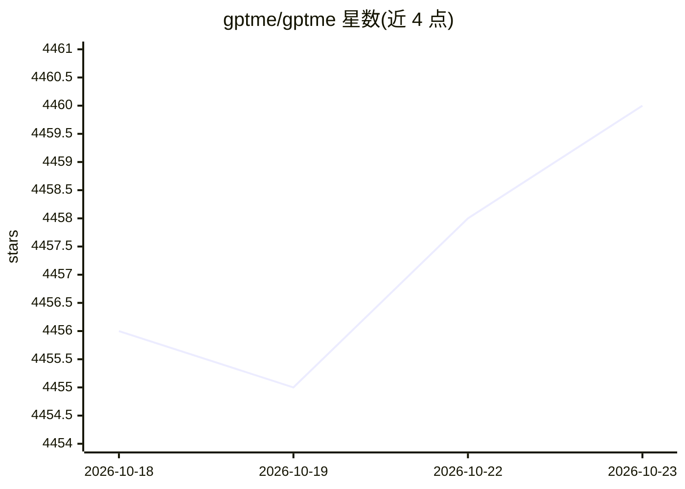

# gptme/gptme

⭐ 4,460 · Python · MIT · 推送 2026-10-22 · [GitHub](https://github.com/gptme/gptme) · [官网](https://gptme.org/) · 组织维护

**终端里的个人 AI agent：写代码、跑命令、浏览网页**

运行于终端的个人 AI agent，随附 shell、Python、浏览器（Playwright）、视觉、文件读写等内置工具，输出反馈回模型以实现自我修正。支持 Anthropic、OpenAI、Google、DeepSeek 等多种提供商，可经 OpenRouter/Requesty 访问 100+ 模型，也可用 Ollama/LM Studio/vLLM/llama.cpp 本地运行，或复用 ChatGPT/SuperGrok 订阅。提供 TUI、Web UI、REST API、MCP/ACP 集成、插件与技能系统，并有 gptme-agent-template 支撑持久自主 agent。自 2023 年 3 月起开发，README 称仍处于活跃开发中。

## 筛选速览

| 维度 | 判定 | 备注 |
|---|---|---|
| AI 角色 | `ai-native` | 本体是模型或模型工具 |
| 许可风险 | `permissive` | MIT |
| 部署形态 | `library` | 以包/库形式分发 |
| 模型依赖 | local-ok | 支持本地模型 |
| 硬件要求 | — | 无带数字的原话,不猜 |
| 安装摩擦 | `low` | 无编译、无系统依赖或容器化 |
| 成熟度 | — | 结构信号不足 |

## 能力要点

- 内置 shell/ipython/browser/vision 等 15+ 工具，输出反馈可自我修正
- 提供商无关：多家 API、OpenRouter/Requesty、本地 Ollama/vLLM/llama.cpp、复用现有订阅
- MCP 客户端与服务端双向支持，ACP 使其可作为 Zed/JetBrains 中的编码 agent
- gptme-agent-template 提供持久自主 agent 脚手架（运行循环、任务队列、多 agent 协调）

## 适用场景

- 在终端中让 AI 直接执行编码、运行命令与浏览网页
- 把 gptme 作为 MCP server 暴露给 Claude Desktop 或 Cursor
- 基于模板搭建持续运行、带记忆的自主 agent
- 用现有 ChatGPT/SuperGrok 订阅而非 API key 驱动 agent

## 场景标签

`AI 助手` `编码 Agent` `浏览器自动化` · 领域:效率与自动化

## 证据(README 行号)

> L49: 📜 A personal AI agent that runs anywhere a terminal runs — your laptop,
> L151: - 💻 **Code execution**
> L171:  - Anthropic (Claude), OpenAI (GPT), Google (Gemini), SpaceXAI (Grok), DeepSeek, and more.

## 星数曲线

2026-10-18 4,456 → 2026-10-23 4,460（+4）

---
*卡片 v1 · prompt 1.4 · 生成 2026-10-20 · 置信度 high · 依据 README sha `5f67c793e062` · [字段定义](../../DATASET.md)*
