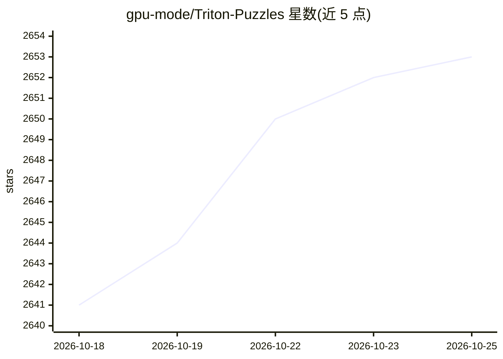

# gpu-mode/Triton-Puzzles

⭐ 2,653 · Jupyter Notebook · Apache-2.0 · 推送 2026-04-01 · [GitHub](https://github.com/gpu-mode/Triton-Puzzles) · 组织维护

**Triton GPU 编程教学谜题集，无需 GPU 即可练习**

面向 GPU 加速编程学习者的交互式谜题集，教授从零开始使用 Triton 语言：从简单示例逐步进阶到 Flash Attention 与量化神经网络等真实算法。谜题通过 Triton interpreter 运行，因此不需要 GPU 硬件。Triton 是可编译到 GPU 等加速器的高级开源语言，语法语义接近 Numpy 和 PyTorch；谜题重点训练内存加载与存储等底层细节。提供 Colab 打开方式，为 GPU MODE 谜题系列第 7 期。

## 筛选速览

| 维度 | 判定 | 备注 |
|---|---|---|
| AI 角色 | `ai-knowledge` | 知识聚合/清单类 |
| 许可风险 | `permissive` | Apache-2.0 |
| 部署形态 | `None` |  |
| 模型依赖 | — | README 未给出锁定关系 |
| 硬件要求 | — | 无带数字的原话,不猜 |
| 安装摩擦 | `medium` | 含编译或系统依赖之一 |
| 成熟度 | — | 结构信号不足 |

## 能力要点

- 交互式谜题从基础到 Flash Attention 与量化神经网络
- 使用 Triton interpreter，无需 GPU 即可运行
- 基于 Triton-Viz，配套 Discord 社区

## 适用场景

- 通过动手谜题学习 Triton 语言基础
- 在无 GPU 环境下练习 GPU 编程的内存与加载细节
- 系统学习 GPU 加速编程谜题系列的一环

## 场景标签

`教程课程` · 领域:学习与行业

## 证据(README 行号)

> L12: This set of puzzles is meant to teach you how to use Triton from first principles in an interactive fashion. You wi
> L7: Programming for accelerators such as GPUs is critical for modern AI systems.

## 星数曲线

2026-10-18 2,641 → 2026-10-25 2,653（+12）

---
*卡片 v1 · prompt 1.4 · 生成 2026-10-21 · 置信度 high · 依据 README sha `2cad022e95de` · [字段定义](../../DATASET.md)*
