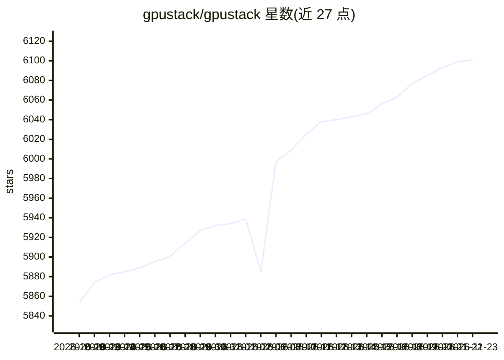

# gpustack/gpustack

⭐ 6,101 · Python · Apache-2.0 · 推送 2026-11-20 · [GitHub](https://github.com/gpustack/gpustack) · [官网](https://gpustack.ai) · 组织维护 · 中文 README

**AI 模型服务的 GPU 集群管理器：调度推理引擎与 GPU 实例**

GPUStack 是一个开源 GPU 集群管理平台，用于 AI 模型服务与 GPU 实例供给：配置并编排 vLLM、SGLang、TensorRT-LLM 等推理引擎，支持按需启动 SSH 可访问的 GPU 实例。功能覆盖多集群 GPU 管理（本地/K8s/云）、GPU 切片与显存/算力分配、内置压测 Auto Tune、故障恢复、负载均衡、监控、认证与访问控制。提供 OpenAI 兼容 API 端点与 UI Playground，面向开发团队、IT 组织与服务提供商交付 Model-as-a-Service。

## 筛选速览

| 维度 | 判定 | 备注 |
|---|---|---|
| AI 角色 | `ai-ecosystem` | LLM/agent 周边工具 |
| 许可风险 | `permissive` | Apache-2.0 |
| 部署形态 | `self-host` | docker 或自建部署 |
| 模型依赖 | local-ok | 支持本地模型 |
| 硬件要求 | — | 无带数字的原话,不猜 |
| 安装摩擦 | `low` | 无编译、无系统依赖或容器化 |
| 成熟度 | — | 结构信号不足 |

## 能力要点

- 多集群 GPU 管理，支持 GPU 切片与可配置显存/算力分配
- 可插拔推理引擎（vLLM、SGLang、TensorRT-LLM），支持自定义引擎
- 内置 Auto Tune 压测与预调优的低延迟/高吞吐模式
- 支持 NVIDIA/AMD/Ascend/Hygon 等多种加速器

## 适用场景

- 在企业内搭建 Model-as-a-Service 平台统一管理 GPU 与模型部署
- 管理本地与云端多个 GPU 集群的推理服务
- 按需启动 SSH 可访问的 GPU 实例做开发与微调
- 通过 Auto Tune 压测确定服务可承载的峰值吞吐

## 场景标签

`推理引擎` `模型网关` · 领域:Agent 开发

## 证据(README 行号)

> L18: GPUStack is an open-source GPU cluster manager for AI model serving and GPU instance provisioning. It configures an
> L30: GPUStack enables development teams, IT organizations, and service providers to deliver Model-as-a-Service at scale.

## 星数曲线

2026-10-20 5,853 → 2026-11-23 6,101（+248）

---
*卡片 v1 · prompt 1.4 · 生成 2026-11-22 · 置信度 high · 依据 README sha `61b2a7d2c0f6` · [字段定义](../../DATASET.md)*
