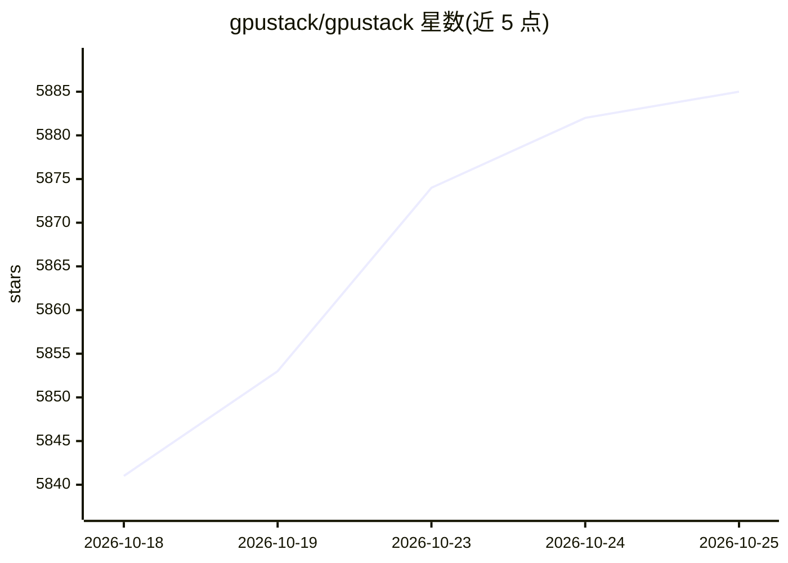

# gpustack/gpustack

⭐ 5,885 · Python · Apache-2.0 · 推送 2026-10-23 · [GitHub](https://github.com/gpustack/gpustack) · [官网](https://gpustack.ai) · 组织维护 · 中文 README

**开源 GPU 集群管理器：统一调度与部署 AI 模型推理服务**

面向开发团队、IT 组织与服务提供商的 GPU 集群管理系统：编排 vLLM、SGLang、TensorRT-LLM 等推理引擎部署模型，提供 OpenAI 兼容 API、负载均衡、监控计量与访问控制，并支持按需启动 SSH 可访问的 GPU 实例。调度器跨本地、Kubernetes 与云端分配 GPU 资源，支持 NVIDIA/AMD/Ascend 等 9 类加速器。以 Docker 容器方式安装，worker 节点仅支持 Linux。另有 GPUStack Enterprise 提供 GPU 拓扑视图等功能。

## 筛选速览

| 维度 | 判定 | 备注 |
|---|---|---|
| AI 角色 | `ai-ecosystem` | LLM/agent 周边工具 |
| 许可风险 | `permissive` | Apache-2.0 |
| 部署形态 | `self-host` | docker 或自建部署 |
| 模型依赖 | local-ok | 支持本地模型 |
| 硬件要求 | — | 无带数字的原话,不猜 |
| 安装摩擦 | `low` | 无编译、无系统依赖或容器化 |
| 成熟度 | — | 结构信号不足 |

## 能力要点

- 编排 vLLM/SGLang/TensorRT-LLM 等可插拔推理引擎，支持自定义引擎
- 跨本地、Kubernetes 与云环境的多集群 GPU 管理与调度
- 按需启动 SSH 可访问的 GPU 实例用于开发与微调
- 内置 OpenAI 兼容 API、认证鉴权、Grafana/Prometheus 监控与故障恢复

## 适用场景

- 把多台 GPU 服务器组成集群统一部署与运维 LLM 推理服务
- 以 Model-as-a-Service 方式向团队提供带 API key 计量的模型服务
- 按需分配 GPU 实例给开发、微调或交互式工作负载

## 场景标签

`推理引擎` `MLOps` · 领域:训练与推理

## 证据(README 行号)

> L18: GPUStack is an open-source GPU cluster manager for AI model serving and GPU instance provisioning. It configures an
> L28: GPUStack enables development teams, IT organizations, and service providers to deliver Model-as-a-Service at scale.
> L30: The figure below illustrates how a single GPUStack server can manage multiple GPU clusters across both on-premises 

## 星数曲线

2026-10-18 5,841 → 2026-10-25 5,885（+44）

---
*卡片 v1 · prompt 1.4 · 生成 2026-10-20 · 置信度 high · 依据 README sha `0ed5d1ad562e` · [字段定义](../../DATASET.md)*
