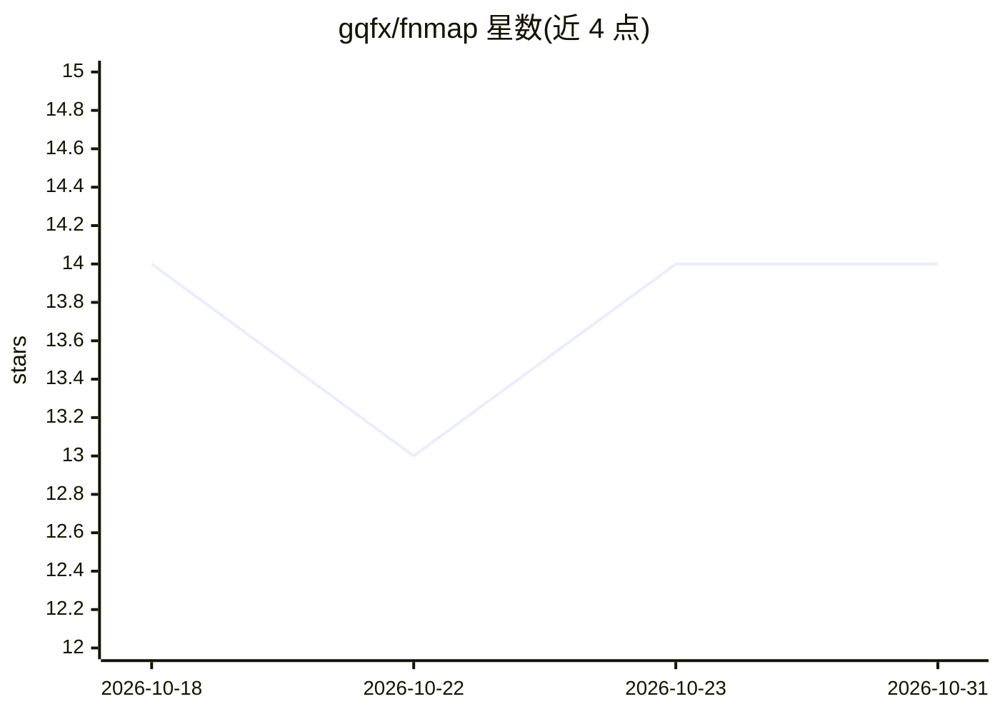

# gqfx/fnmap

⭐ 14 · TypeScript · 推送 2026-03-27 · [GitHub](https://github.com/gqfx/fnmap) · [官网](https://fnmap.vdiff.dev/) · 个人维护 · 中文 README

**JS/TS 代码索引工具：生成供 AI 助手读取的代码结构地图**

基于 @babel/parser AST 解析的命令行与 Node.js 库，分析 JS/TS/JSX/TSX 代码，生成包含导入、函数、类、常量、调用图的 .fnmap 索引文件。面向使用 AI 编码助手的开发者：--init 可将格式文档追加到 CLAUDE.md/AGENTS.md，使 Claude 等助手按行号定位代码。支持 git 变更增量处理、pre-commit 钩子与 CI/CD 集成，自动过滤类型定义文件，限制单文件 10MB、目录深度 50 层。npm 全局或项目内安装。

## 筛选速览

| 维度 | 判定 | 备注 |
|---|---|---|
| AI 角色 | `ai-ecosystem` | LLM/agent 周边工具 |
| 许可风险 | `none` | — |
| 部署形态 | `library` | 以包/库形式分发 |
| 模型依赖 | — | README 未给出锁定关系 |
| 硬件要求 | — | 无带数字的原话,不猜 |
| 安装摩擦 | `low` | 无编译、无系统依赖或容器化 |
| 成熟度 | — | 结构信号不足 |

## 能力要点

- AST 解析生成含调用图与行号的 .fnmap 结构化索引
- --init 向 CLAUDE.md/AGENTS.md 追加 AI 可读格式文档
- git 集成：仅处理变更文件、pre-commit 钩子自动更新索引
- 提供 Node.js 编程 API（processCode/processFile）

## 适用场景

- 为 Claude Code 等 AI 助手生成代码库导航索引
- 提交代码时自动保持索引与代码同步
- 在 CI 中检测索引是否已更新

## 场景标签

 · 领域:开发者工具/代码分析

## 证据(README 行号)

> L6: > AI code indexing tool for analyzing JS/TS code structure and generating structured code maps
> L159: fnmap is designed to help AI coding assistants understand your codebase better:

## 星数曲线

2026-10-18 14 → 2026-10-31 14（+0）

---
*卡片 v1 · prompt 1.4 · 生成 2026-10-31 · 置信度 high · 依据 README sha `dd0e475fe92d` · [字段定义](../../DATASET.md)*
