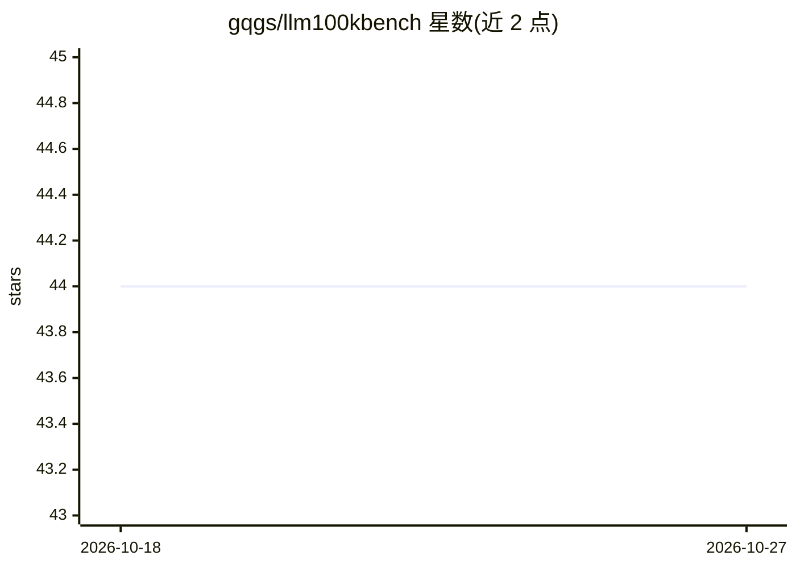

# gqgs/llm100kbench

⭐ 44 · Go · 推送 2026-10-26 · [GitHub](https://github.com/gqgs/llm100kbench) · 个人维护

**评测 LLM 投资决策的基准：每周自动跑投资组合并跟踪表现**

一个跟踪大模型投资决策表现的基准框架：通过 create/list/update/stocks 等命令创建与管理各模型生成的投资组合，GitHub Actions 每周一自动运行，写入模型订单、市场价格快照、决策日志并更新数据库与 README 展示。仅使用免费 API 层级的模型，付费或订阅制模型被归档不参与自动运行。当前在跑的基准身份包括 chatgpt、deepseek、grok 等，各组合以 10 万美元起始并按持仓汇总净值。

## 筛选速览

| 维度 | 判定 | 备注 |
|---|---|---|
| AI 角色 | `ai-ecosystem` | LLM/agent 周边工具 |
| 许可风险 | `none` | — |
| 部署形态 | `None` |  |
| 模型依赖 | locked-api |  |
| 硬件要求 | — | 无带数字的原话,不猜 |
| 安装摩擦 | `low` | 无编译、无系统依赖或容器化 |
| 成熟度 | — | 结构信号不足 |

## 能力要点

- GitHub Actions 每周自动运行并记录订单、价格快照与决策日志
- 仅限免费 API 层级的模型，付费模型归档不自动运行
- cmd 下提供 create/list/update/stocks 命令管理组合
- 每个订单记录后端模型 ID 元数据

## 适用场景

- 跟踪多个 LLM 在真实市场数据下的投资决策表现
- 比较不同模型构建的投资组合净值变化
- 查看被拒答模型响应的验证记录

## 场景标签

`模型评测` `金融量化` · 领域:评测与运维

## 证据(README 行号)

> L3: A tool for benchmarking and tracking Large Language Model (LLM) investment decisions.
> L16: The active model roster is configured in models.json. The weekly GitHub Actions workflow runs the benchmark every M

## 星数曲线

2026-10-18 44 → 2026-10-27 44（+0）

---
*卡片 v1 · prompt 1.4 · 生成 2026-10-25 · 置信度 high · 依据 README sha `b5e01917d7bd` · [字段定义](../../DATASET.md)*
