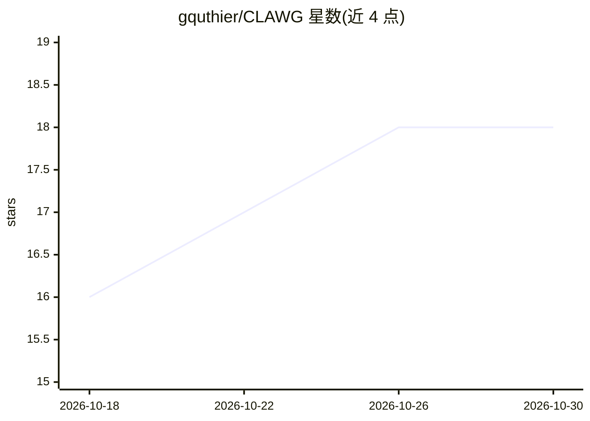

# gquthier/CLAWG

⭐ 18 · Python · MIT · 推送 2026-08-03 · [GitHub](https://github.com/gquthier/CLAWG) · 个人维护

**让多个 agent 共享同一 Obsidian 知识库上下文的自主 agent 框架**

开源 Python 框架，为自主 agent 提供统一的共享上下文层：以一个 Obsidian Second Brain 库（markdown 文件）存放用户画像（user.md）、环境（environment.md）、哲学（philosophy.md）等 master 文件，以及 skills/subagents/tools/api/learning 等共享能力目录和 per-agent 身份文件（identity.md、soul.md）。通过 Obsidian Sync 使任意 Claude Code 会话跨设备加载同一上下文；提供 clawg CLI 命令进行链接、初始化、校验和启动会话。支持 macOS/Linux/WSL2，经 shell 脚本安装或从源码构建，MIT 许可，由个人开发者 Gauthier Thiry 维护。

## 筛选速览

| 维度 | 判定 | 备注 |
|---|---|---|
| AI 角色 | `ai-ecosystem` | LLM/agent 周边工具 |
| 许可风险 | `permissive` | MIT |
| 部署形态 | `library` | 以包/库形式分发 |
| 模型依赖 | — | README 未给出锁定关系 |
| 硬件要求 | — | 无带数字的原话,不猜 |
| 安装摩擦 | `low` | 无编译、无系统依赖或容器化 |
| 成熟度 | — | 结构信号不足 |

## 能力要点

- 单一 vault 存放 master 上下文文件与共享 skills/tools/API
- per-agent 身份配置（identity.md、AGENTS.md、soul.md）与确定性加载
- Obsidian Sync 跨会话/跨设备同步上下文
- clawg CLI 提供 link/init/status/会话启动命令

## 适用场景

- 让多个 agent 会话共享同一份用户与环境上下文，避免重复说明
- 在 Obsidian 中用 markdown 编辑上下文并复用于 CLI agent
- 个人多 agent 工作流的自托管上下文管理

## 场景标签

`Agent 框架` `Agent 记忆` · 领域:Agent 开发

## 证据(README 行号)

> L5: # Autonomous Agent Framework
> L20: Every session can load shared markdown context from one vault so all agents work from the same source of truth:
> L33: - Multi-agent architecture with deterministic profile loading

## 星数曲线

2026-10-18 16 → 2026-10-30 18（+2）

---
*卡片 v1 · prompt 1.4 · 生成 2026-10-29 · 置信度 mid · 依据 README sha `1c7ef8956160` · [字段定义](../../DATASET.md)*
