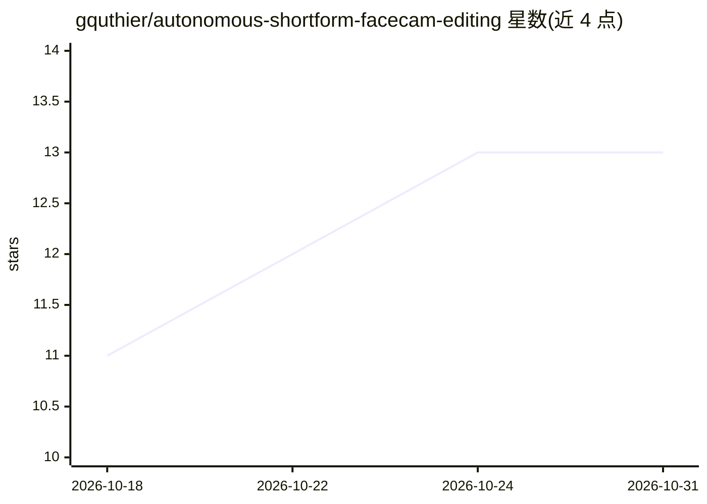

# gquthier/autonomous-shortform-facecam-editing

⭐ 13 · Python · MIT · 推送 2026-08-26 · [GitHub](https://github.com/gquthier/autonomous-shortform-facecam-editing) · 个人维护

**Claude Code 技能：把一段口播视频自动做成成片广告**

面向 Claude Code 的技能包（SKILL.md + 可运行脚本 + playbook）：输入一段原始 talking-head 视频与品牌 URL，由 AI 编码代理完成素材预处理（ffmpeg 静音剪切、OpenCV 人脸居中裁切）、whisper.cpp 词级转录、Playwright 品牌截图与配色抓取，按句生成 11 种动态图形卡片与卡拉OK字幕，经 HyperFrames（HTML+GSAP→MP4）确定性渲染为 1080×1920 成片，含 QA 循环。通过 git clone 安装到 ~/.claude/skills 后由 Claude Code 自动触发。声音生成用 ElevenLabs API，可选。

## 筛选速览

| 维度 | 判定 | 备注 |
|---|---|---|
| AI 角色 | `ai-ecosystem` | LLM/agent 周边工具 |
| 许可风险 | `permissive` | MIT |
| 部署形态 | `library` | 以包/库形式分发 |
| 模型依赖 | locked-api |  |
| 硬件要求 | — | 无带数字的原话,不猜 |
| 安装摩擦 | `medium` | 含编译或系统依赖之一 |
| 成熟度 | — | 结构信号不足 |

## 能力要点

- 一段原始口播 + 品牌 URL → 1080×1920 动态图形广告成片
- 11 种卡片原型、4 种构图模式、词级同步卡拉OK字幕
- ffmpeg/OpenCV 素材预处理 + whisper.cpp 词级转录 + Playwright 品牌素材抓取
- HyperFrames HTML+GSAP → MP4 确定性渲染，附 QA 检查脚本

## 适用场景

- 把一段口播录像自动剪辑成投放用竖屏广告
- 让 AI 代理按品牌网站风格生成动态图形与字幕
- 批量生产付费社交短视频草稿后人工微调

## 场景标签

`编码 Agent` `视频生成` · 领域:编码与开发

## 证据(README 行号)

> L18: This is a **Claude Code skill** + a complete playbook (with runnable scripts) that turns **one raw
> L104: ## Install as a Claude Code skill

## 星数曲线

2026-10-18 11 → 2026-10-31 13（+2）

---
*卡片 v1 · prompt 1.4 · 生成 2026-10-31 · 置信度 high · 依据 README sha `66769bc52c2d` · [字段定义](../../DATASET.md)*
