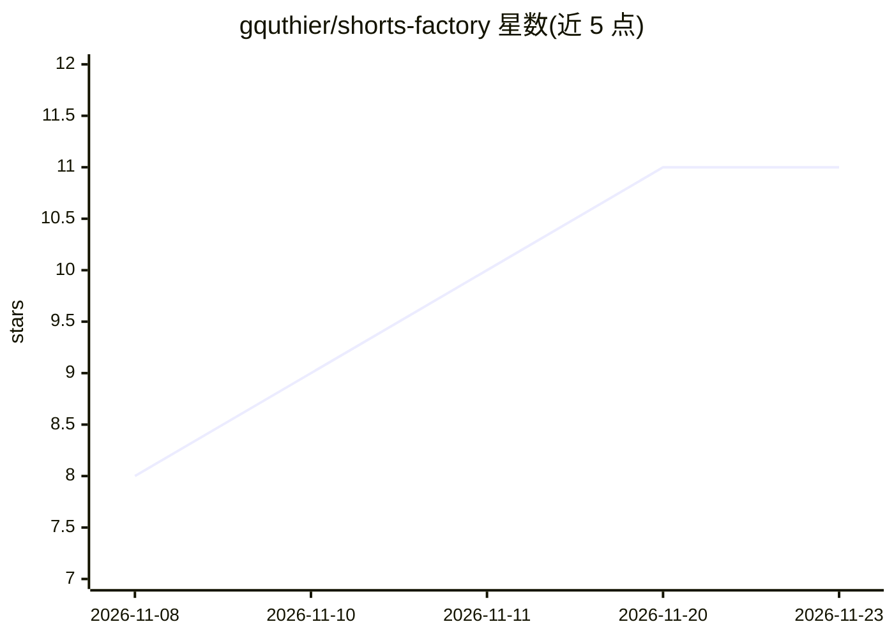

# gquthier/shorts-factory

⭐ 11 · TypeScript · MIT · 推送 2026-11-14 · [GitHub](https://github.com/gquthier/shorts-factory) · [官网](https://gquthier.github.io/shorts-factory/) · 个人维护 · 中文 README

**把自有长视频转为竖版短视频并完成发布复盘的 Mac 工作室**

Electron 桌面应用，将自有长视频经导入、转录、选段、剪辑、写 hook、渲染、审核到发布的完整流程做成竖版短片。文本生成接入 Anthropic API 或 Claude CLI 提取选段与 hook，转录用本地 Whisper（可选 ElevenLabs 时间戳），渲染依赖 Apple Vision，任务队列基于 SQLite，密钥存 macOS Keychain。提供 6 种版式、22 个技能与频道数据分析；界面以法语为主。

## 筛选速览

| 维度 | 判定 | 备注 |
|---|---|---|
| AI 角色 | `ai-native` | 本体是模型或模型工具 |
| 许可风险 | `permissive` | MIT |
| 部署形态 | `None` |  |
| 模型依赖 | locked-api |  |
| 硬件要求 | — | 无带数字的原话,不猜 |
| 安装摩擦 | `medium` | 含编译或系统依赖之一 |
| 成熟度 | `idea` | |

## 能力要点

- 导入自有视频，按词级时间戳剪切并生成字幕
- 每个 hook 附具体观众问题与对应原文片段，并有二次判定检查忠实度
- 6 种版式（分屏、黑框、影院 talk、自拍标题、问答卡、字体纵深）
- SQLite 任务队列可恢复，发布后按频道对比格式/主题中位数

## 适用场景

- 把自有长视频批量切成可发布的竖版短片
- 发布前在审核队列里检查并改写每个片段的 hook
- 按频道数据对比不同格式/主题的表现并生成新选题

## 场景标签

`图像视频处理` `数据分析` · 领域:效率与自动化

## 证据(README 行号)

> L9: An open-source Electron studio for turning your own videos into vertical clips. Find the useful moments, write groun
> L32: |**Anthropic API or Claude CLI**|Extract selection, editing decisions, hooks and ideas|One text-generation option|
> L41: **Import → Transcribe → Find moments → Cut → Write hooks → Render → Check → Review → Publish → Learn**

## 星数曲线

2026-11-08 8 → 2026-11-23 11（+3）

---
*卡片 v1 · prompt 1.4 · 生成 2026-11-19 · 置信度 high · 依据 README sha `a434326dff45` · [字段定义](../../DATASET.md)*
