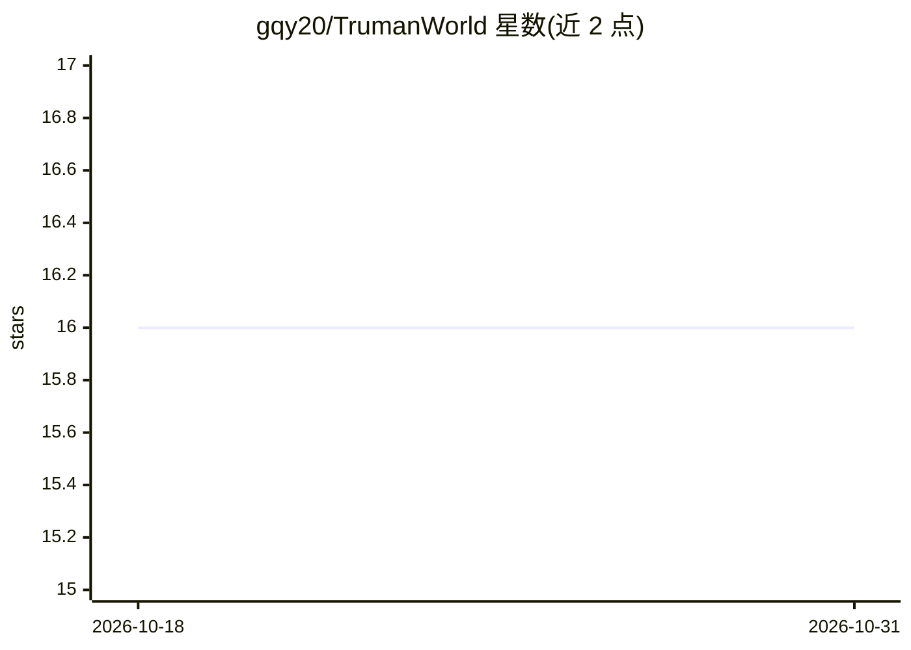

# gqy20/TrumanWorld

⭐ 16 · Python · MIT · 推送 2026-09-14 · [GitHub](https://github.com/gqy20/TrumanWorld) · [官网](https://truman.gqy25.top/) · 个人维护 · 中文 README

**AI 社会模拟系统：观察不知自己是 AI 的小镇居民共同生活**

基于 FastAPI 后端与 Next.js 前端的 AI 社会模拟系统，借鉴斯坦福 Generative Agents 的记忆流、反思、规划架构。用户扮演导演：创建世界、定义居民关系、注入事件，但不能操控居民想法；主角 Truman 不知道自己是 AI，会产生怀疑并寻求真相。提供导演控制台（世界视图、时间线、Agent 详情、事件回放）、truman CLI、治理与最小经济状态；需本地 PostgreSQL 或 Neon 数据库，前端用 pnpm、Node 24.3.0。定位为持续演进中的实验系统而非完成的 MVP。

## 筛选速览

| 维度 | 判定 | 备注 |
|---|---|---|
| AI 角色 | `ai-native` | 本体是模型或模型工具 |
| 许可风险 | `permissive` | MIT |
| 部署形态 | `None` |  |
| 模型依赖 | — | README 未给出锁定关系 |
| 硬件要求 | — | 无带数字的原话,不猜 |
| 安装摩擦 | `low` | 无编译、无系统依赖或容器化 |
| 成熟度 | `idea` | |

## 能力要点

- 借鉴 Generative Agents 记忆流/反思/规划认知架构
- 导演只注入事件、不操控居民决策的干预机制
- 导演控制台含世界视图、时间线、Agent 详情、事件回放
- 统一 truman CLI 经 FastAPI 操作世界，支持预算保护

## 适用场景

- 观察 AI 社会的涌现行为与社交动态
- 生成故事情节与角色关系并按 Tick 回放复盘
- 研究 AI agent 的产品形态边界

## 场景标签

`多智能体` · 领域:Agent 开发

## 证据(README 行号)

> L13: 一个面向实验与观测的 AI 社会模拟系统。在这个小镇里，AI 居民们自然地生活、工作、社交。
> L47: - **Generative Agents** — 斯坦福大学开创性研究，首次展示 AI 能在虚拟小镇中自然生活、社交。提出了三个核心组件：记忆流（Memory Stream）、反思（Reflection）、规划（Plan）。本项

## 星数曲线

2026-10-18 16 → 2026-10-31 16（+0）

---
*卡片 v1 · prompt 1.4 · 生成 2026-10-30 · 置信度 high · 依据 README sha `1b429347cc23` · [字段定义](../../DATASET.md)*
