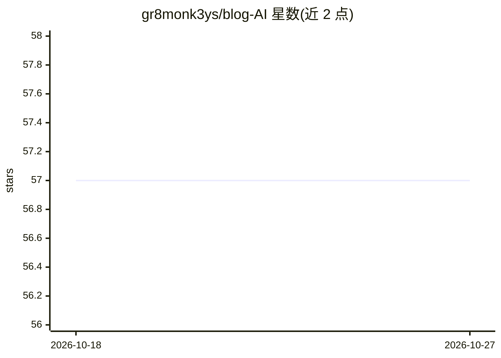

# gr8monk3ys/blog-AI

⭐ 57 · Python · AGPL-3.0 · 推送 2026-10-26 · [GitHub](https://github.com/gr8monk3ys/blog-AI) · [官网](https://blog-ai.vivancedata.com) · 个人维护

**按训练的品牌口吻生成长文博客与书籍的 Web 应用**

Next.js 前端 + FastAPI 后端 + 浏览器扩展的内容生成应用：以多个小 LLM 调用组成流水线，先联网调研（最多 8 个引用来源）、生成大纲、逐节撰写并注入品牌口吻摘要，再做校对与拟人化；可选 SEO 循环改写至分数阈值与逐条事实核查。OpenAI/Anthropic/Gemini 接在统一的 generate_text() 之后，含重试与限流。本地运行需 Bun 1.4.3、Python 3.12 与一个 LLM API key；开发模式下 Clerk 与数据库可选，AGPL-3.0 许可。

## 筛选速览

| 维度 | 判定 | 备注 |
|---|---|---|
| AI 角色 | `ai-native` | 本体是模型或模型工具 |
| 许可风险 | `viral` | AGPL-3.0 |
| 部署形态 | `self-host` | docker 或自建部署 |
| 模型依赖 | — | README 未给出锁定关系 |
| 硬件要求 | — | 无带数字的原话,不猜 |
| 安装摩擦 | `low` | 无编译、无系统依赖或容器化 |
| 成熟度 | — | 结构信号不足 |

## 能力要点

- 流水线式生成：调研→大纲→逐节撰写→校对→拟人化
- 可选 SEO 循环改写与逐条声明事实核查
- OpenAI/Anthropic/Gemini 经统一 generate_text() 接入，含重试与限流
- 每个阶段为独立函数并带测试，可诊断可替换

## 适用场景

- 用自有品牌口吻批量生成长文博客
- 生成带引用来源与事实核查的内容
- 按 SEO 分数阈值迭代改写文章

## 场景标签

`AI 写作` · 领域:内容生成

## 证据(README 行号)

> L3: Generates long-form blog posts and books in a trained brand voice, then publishes them.
> L7: prompt. A post is researched (web search, up to 8 cited sources), outlined, written one

## 星数曲线

2026-10-18 57 → 2026-10-27 57（+0）

---
*卡片 v1 · prompt 1.4 · 生成 2026-10-24 · 置信度 high · 依据 README sha `2fe14e829df6` · [字段定义](../../DATASET.md)*
