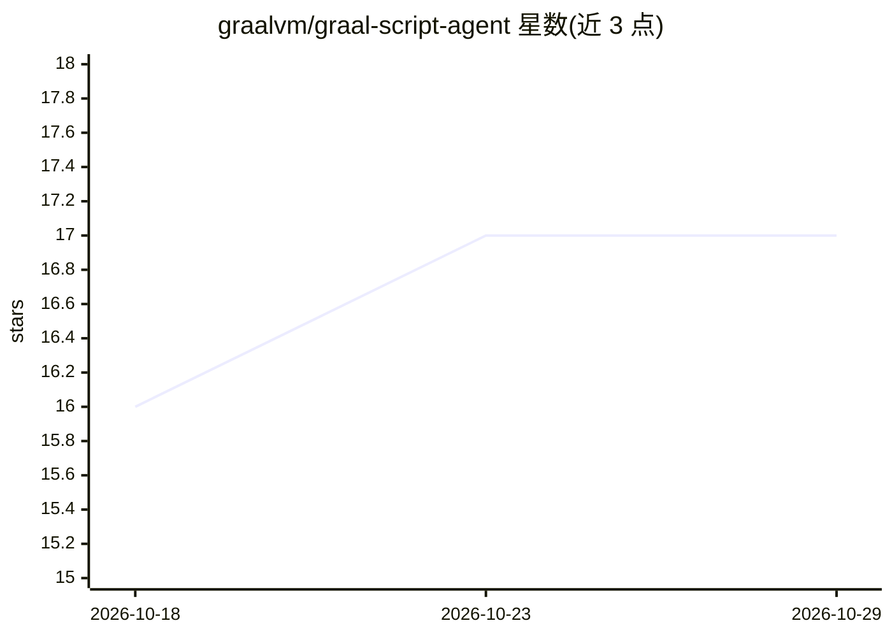

# graalvm/graal-script-agent

⭐ 17 · Java · UPL-1.0 · 推送 2026-09-06 · [GitHub](https://github.com/graalvm/graal-script-agent) · [官网](https://graalvm.github.io/graal-script-agent/) · 组织维护

**Java 库：通过提示词让 LLM 生成可复用的 JS/Python 应用扩展**

面向 Java 开发者的早期预览库：应用定义 Java 接口描述扩展点，ScriptAgent 引导语言模型按该契约实现，返回类型化的 Script<T>，可检视、存储与复用。与常规编码 agent 不同，它产出 JavaScript 或 Python 扩展而非修改源码仓库，适合搜索、报表、路由规则、校验等有边界的应用行为。脚本绑定到应用自身的沙箱化 GraalVM 上下文执行，执行为本地且无需再次调用模型。构件发布于 Maven Central，支持 Maven/Gradle 依赖配置，含模型适配器与客户语言运行时。

## 筛选速览

| 维度 | 判定 | 备注 |
|---|---|---|
| AI 角色 | `ai-ecosystem` | LLM/agent 周边工具 |
| 许可风险 | `viral` | UPL-1.0 |
| 部署形态 | `None` |  |
| 模型依赖 | — | README 未给出锁定关系 |
| 硬件要求 | — | 无带数字的原话,不猜 |
| 安装摩擦 | `low` | 无编译、无系统依赖或容器化 |
| 成熟度 | `idea` | |

## 能力要点

- 提示词驱动的应用扩展生成，产出 JS/Python 而非修改源码
- 类型化 Script<T> 契约，可检视、存储与复用
- 脚本在沙箱化 GraalVM 上下文本地执行，无需再次调用模型
- Maven Central 发布，支持 Maven/Gradle 及模型适配器

## 适用场景

- 让用户用自然语言为 Java 应用添加报表、搜索或路由规则等扩展
- 在沙箱中安全运行 AI 生成的脚本逻辑
- 为应用构建提示词即插件的扩展机制

## 场景标签

`代码生成` · 领域:编码与开发

## 证据(README 行号)

> L7: Graal Script Agent is an early-preview Java library for adding prompt-authored extensions to Java applications. Deve
> L13: The application defines a Java interface describing an extension point and the data and operations available to it.

## 星数曲线

2026-10-18 16 → 2026-10-29 17（+1）

---
*卡片 v1 · prompt 1.4 · 生成 2026-10-29 · 置信度 high · 依据 README sha `60ee40be62ee` · [字段定义](../../DATASET.md)*
