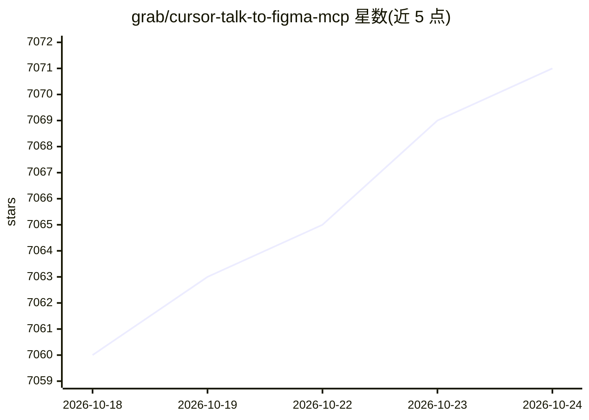

# grab/cursor-talk-to-figma-mcp

⭐ 7,071 · JavaScript · MIT · 推送 2026-07-26 · [GitHub](https://github.com/grab/cursor-talk-to-figma-mcp) · [官网](https://www.figma.com/community/plugin/1485687494525374295/cursor-talk-to-figma-mcp-plugin) · 组织维护

**让 AI Agent 通过 MCP 读写和修改 Figma 设计的工具**

由 Grab 团队维护的 MCP 集成项目：包含 TypeScript 实现的 MCP server、Figma 插件和一个 WebSocket server，三者协作使 Cursor、Claude Code 等 AI agent 能读取 Figma 文档结构、读写文本、创建/移动/删除节点、设置样式与 Auto Layout、管理组件实例覆盖、导出图片等。通过 bun 完成安装与启动，Figma 插件可从社区页安装或本地链接开发。附 Windows + WSL 配置指南与批量文本替换等设计自动化示例。

## 筛选速览

| 维度 | 判定 | 备注 |
|---|---|---|
| AI 角色 | `ai-ecosystem` | LLM/agent 周边工具 |
| 许可风险 | `permissive` | MIT |
| 部署形态 | `None` |  |
| 模型依赖 | — | README 未给出锁定关系 |
| 硬件要求 | — | 无带数字的原话,不猜 |
| 安装摩擦 | `low` | 无编译、无系统依赖或容器化 |
| 成熟度 | — | 结构信号不足 |

## 能力要点

- MCP server + Figma 插件 + WebSocket server 三组件架构
- 覆盖文档读取、节点创建/修改、样式、Auto Layout、组件实例覆盖传播等 50+ 工具
- 批量文本替换与组件实例覆盖传播等设计自动化能力
- 提供 7 个引导复杂设计任务的 MCP prompts

## 适用场景

- 在 Cursor 或 Claude Code 中用自然语言批量替换 Figma 设计文本
- 让 AI agent 读取并分析现有 Figma 设计结构
- 通过 AI 将原型反应可视化为 FigJam 连接线

## 场景标签

 · 领域:设计工具/AI Agent 集成

## 证据(README 行号)

> L3: This project implements a Model Context Protocol (MCP) integration between AI agent (Cursor, Claude Code) and Figma,
> L9: - `src/talk_to_figma_mcp/` - TypeScript MCP server for Figma integration

## 星数曲线

2026-10-18 7,060 → 2026-10-24 7,071（+11）

---
*卡片 v1 · prompt 1.4 · 生成 2026-10-20 · 置信度 high · 依据 README sha `21ef4faed60d` · [字段定义](../../DATASET.md)*
