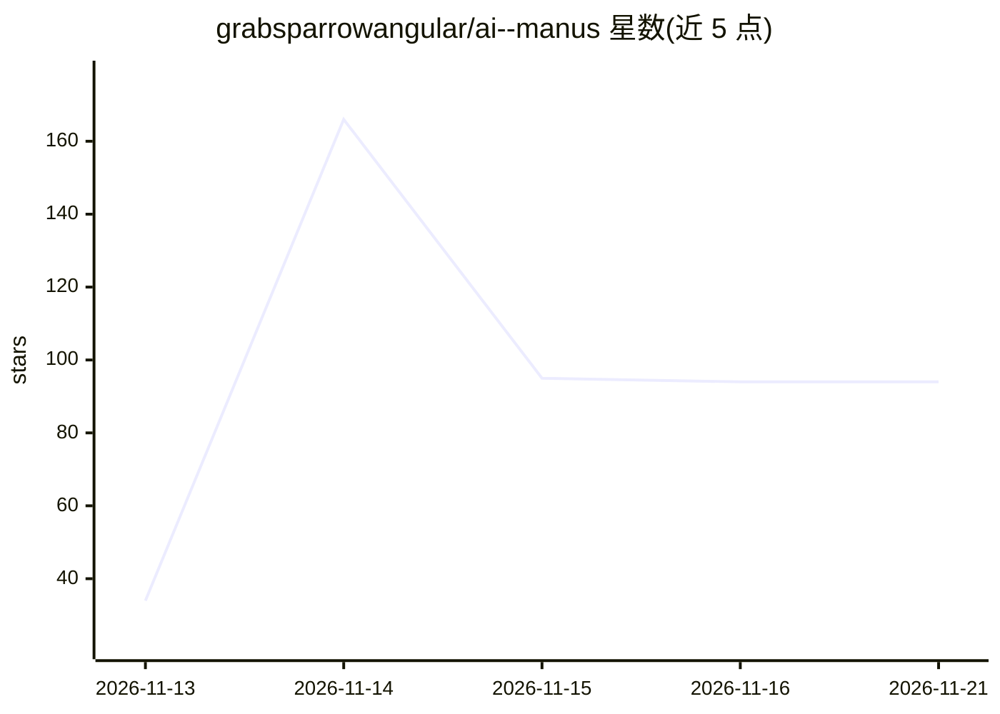

# grabsparrowangular/ai--manus

⭐ 94 · Apache-2.0 · 推送 2026-11-15 · [GitHub](https://github.com/grabsparrowangular/ai--manus) · 个人维护

**面向个人日常任务的自主 AI Agent，执行代码与浏览器操作**

自述为通用自主 AI Agent 系统，声称可在沙箱中运行多种工具：自主执行代码、控制浏览器完成导航/填表/采集、执行多步骤任务，定位为家庭、学习与轻量办公场景的个人助手，非企业平台。README 以功能宣传为主，给出兼容性表（最低 4GB 内存、双核 CPU）与上手/最佳用途说明，但未提供具体安装命令、技术架构、模型接入方式或代码仓库内容说明，实现细节不可验证。

## 筛选速览

| 维度 | 判定 | 备注 |
|---|---|---|
| AI 角色 | `ai-native` | 本体是模型或模型工具 |
| 许可风险 | `permissive` | Apache-2.0 |
| 部署形态 | `None` |  |
| 模型依赖 | — | README 未给出锁定关系 |
| 硬件要求 | — | 无带数字的原话,不猜 |
| 安装摩擦 | `low` | 无编译、无系统依赖或容器化 |
| 成熟度 | — | 结构信号不足 |

## 能力要点

- 自述支持自主代码执行与浏览器控制
- 支持跨代码与浏览器的多步骤任务
- README 给出最低/推荐硬件兼容性表

## 适用场景

- 让 agent 代为完成浏览网页、填表、资料整理等重复性操作
- 学习中运行小脚本、整理研究笔记
- 轻量办公中从多页面收集信息并汇总

## 场景标签

`AI 助手` `浏览器自动化` · 领域:效率与自动化

## 证据(README 行号)

> L10: - **Autonomous Code Execution:** Manus AI agent runs code on its own to complete tasks, so you can focus on decisio
> L18: Manus is an autonomous AI agent designed to run code and control a browser on your behalf. Instead of acting like a

## 星数曲线

2026-11-13 34 → 2026-11-21 94（+60）

---
*卡片 v1 · prompt 1.4 · 生成 2026-11-17 · 置信度 low · 依据 README sha `a3d88e202bf0` · [字段定义](../../DATASET.md)*
