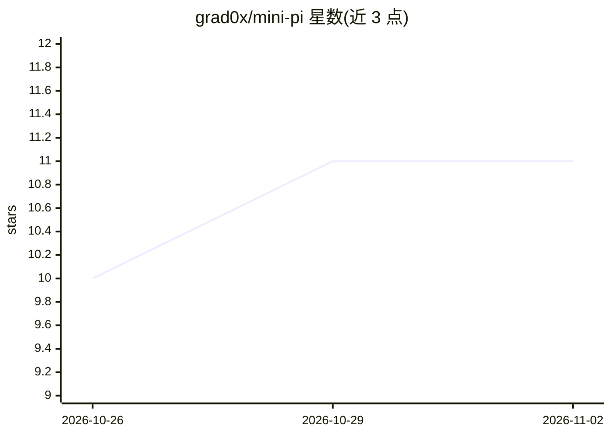

# grad0x/mini-pi

⭐ 11 · TypeScript · 推送 2026-08-10 · [GitHub](https://github.com/grad0x/mini-pi) · [官网](https://feedly.fun/blog/mini-pi-agent-harness) · 个人维护

**研究 Agent 运行时抽象的最小 Coding Agent 框架**

受 Pi 启发的 TypeScript 最小 Agent Harness，用于研究并验证 Agent Runtime 的核心抽象：Agent State、Agent Loop、Context、Tool、Session、Hook 与 Event。v0.1 提供工作区受限的文件/命令工具、JSONL 会话持久化与恢复、上下文编译与投影、工具调用前后 Hook 拦截与策略门。内置确定性 fix-bug 演示与真实 LLM 实验（OpenAI 兼容 Chat Completions 端点）。尚不支持崩溃恢复、压缩、多 Agent 等，能力矩阵中列出未实现项。

## 筛选速览

| 维度 | 判定 | 备注 |
|---|---|---|
| AI 角色 | `ai-ecosystem` | LLM/agent 周边工具 |
| 许可风险 | `none` | — |
| 部署形态 | `library` | 以包/库形式分发 |
| 模型依赖 | — | README 未给出锁定关系 |
| 硬件要求 | — | 无带数字的原话,不猜 |
| 安装摩擦 | `low` | 无编译、无系统依赖或容器化 |
| 成熟度 | — | 结构信号不足 |

## 能力要点

- Agent + Model + Tool + Loop 的最小可执行核心
- JSONL 会话持久化与跨进程恢复、上下文快照与投影
- beforeToolCall/afterToolCall Hook 拦截与策略门（如 DenyCommandPolicy）
- 确定性 fix-bug 演示与真实 LLM 实验（OpenAI 兼容端点）

## 适用场景

- 研究 Agent 运行时/Harness 的抽象设计
- 通过可执行 demo 验证会话持久化、Hook、策略等机制
- 在 OpenAI 兼容端点上运行真实 LLM fix-bug 实验

## 场景标签

`Agent 框架` · 领域:Agent 开发

## 证据(README 行号)

> L3: A minimal Agent Harness implementation inspired by Pi.
> L5: This project is built to study and validate the core abstractions behind
> L6: modern Agent runtimes, including Agent State, Agent Loop, Context, Tool,

## 星数曲线

2026-10-26 10 → 2026-11-02 11（+1）

---
*卡片 v1 · prompt 1.4 · 生成 2026-11-02 · 置信度 high · 依据 README sha `8ff26667a9e0` · [字段定义](../../DATASET.md)*
