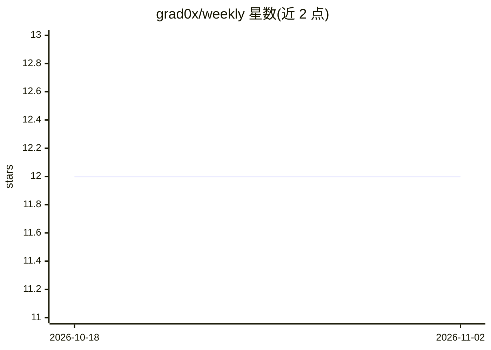

# grad0x/weekly

⭐ 12 · 推送 2026-03-10 · [GitHub](https://github.com/grad0x/weekly) · [官网](https://feedly.fun/week) · 个人维护 · 中文 README

**面向泛前端开发者的 Web 技术周刊（已更新 122 期）**

每周一发布的 Web 技术周刊，汇集技术热闻、大前端技术、产品资讯、设计案例等内容，条目以标题列表形式按期组织，覆盖 2020 年第 1 期至 2023 年第 122 期。主题涉及前端框架、CSS、低代码、Web3，也包含 ChatGPT、SAM、Transformers.js 等 AI 相关资讯。读者可通过公众号、issue 或 PR 推荐文章与反馈，README 顶部声明周刊已迁移至 feedly.fun/week。

## 筛选速览

| 维度 | 判定 | 备注 |
|---|---|---|
| AI 角色 | `ai-knowledge` | 知识聚合/清单类 |
| 许可风险 | `none` | — |
| 部署形态 | `None` |  |
| 模型依赖 | — | README 未给出锁定关系 |
| 硬件要求 | — | 无带数字的原话,不猜 |
| 安装摩擦 | `low` | 无编译、无系统依赖或容器化 |
| 成熟度 | — | 结构信号不足 |

## 能力要点

- 按期组织的技术文章索引（1-122 期，2020-2023）
- 每周一早 10 点前发刊
- 接受读者通过公众号/issue/PR 参与推荐

## 适用场景

- 按期浏览前端与 Web 技术资讯汇总
- 回顾 2020-2023 年前端技术热点变迁
- 向周刊推荐文章或提出改进建议

## 场景标签

`精选清单` · 领域:学习与行业

## 证据(README 行号)

> L5: Web 技术周刊是一款面向泛前端同学汇集技术热闻、大前端技术、产品资讯、设计案例以及精彩发现等内容的周刊，目标是为大家带来更多优质的大前端技术输入。
> L13: ## 目录

## 星数曲线

2026-10-18 12 → 2026-11-02 12（+0）

---
*卡片 v1 · prompt 1.4 · 生成 2026-11-01 · 置信度 high · 依据 README sha `913177827a63` · [字段定义](../../DATASET.md)*
