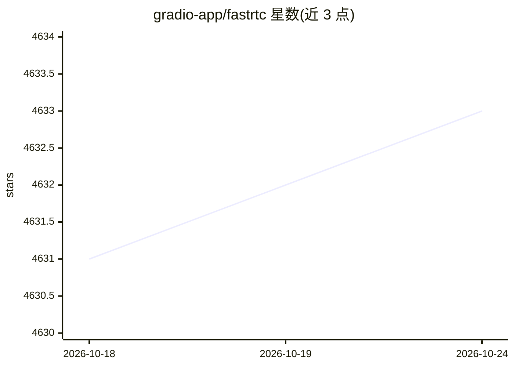

# gradio-app/fastrtc

⭐ 4,633 · JavaScript · MIT · 推送 2026-10-21 · [GitHub](https://github.com/gradio-app/fastrtc) · [官网](https://fastrtc.org/) · 组织维护

**将 Python 函数变为 WebRTC/WebSocket 实时音视频流的库**

面向 Python 开发者的实时通信库：将任意 Python 函数封装为可通过 WebRTC 或 WebSocket 传输的实时音频/视频流。内置语音活动检测与轮次切换（ReplyOnPause）、Gradio 内置 UI、FastAPI 挂载、免费临时电话号码接入（fastphone）。示例覆盖 Gemini/OpenAI/Anthropic 语音对话、Whisper 转录、YOLO 检测、Moshi 语音模型等。以 pip 安装的库形式提供，可挂载到自有 FastAPI 生产应用。

## 筛选速览

| 维度 | 判定 | 备注 |
|---|---|---|
| AI 角色 | `ai-ecosystem` | LLM/agent 周边工具 |
| 许可风险 | `permissive` | MIT |
| 部署形态 | `library` | 以包/库形式分发 |
| 模型依赖 | — | README 未给出锁定关系 |
| 硬件要求 | — | 无带数字的原话,不猜 |
| 安装摩擦 | `low` | 无编译、无系统依赖或容器化 |
| 成熟度 | — | 结构信号不足 |

## 能力要点

- 任意 Python 函数转为 WebRTC/WebSocket 实时音视频流
- 内置语音检测与轮次切换（ReplyOnPause）
- 提供 Gradio 内置 UI、FastAPI 挂载与免费临时电话号码接入三种运行方式
- 示例集成 Gemini/OpenAI/Anthropic 语音 API、Whisper 转录、YOLO 实时检测

## 适用场景

- 为 LLM 构建实时语音对话界面
- 将语音转录或目标检测模型接入实时音视频流
- 通过电话号码让用户呼叫进入语音应用
- 将实时音视频端点挂载到现有 FastAPI 生产系统

## 场景标签

`语音 Agent` · 领域:对话与助手

## 证据(README 行号)

> L9: The Real-Time Communication Library for Python.
> L11: Turn any python function into a real-time audio and video stream over WebRTC or WebSockets.
> L29: - 🔌 Automatic WebRTC Support - Use the `.mount(app)` method to mount the stream on a FastAPI app and get a webRTC e

## 星数曲线

2026-10-18 4,631 → 2026-10-24 4,633（+2）

---
*卡片 v1 · prompt 1.4 · 生成 2026-10-20 · 置信度 high · 依据 README sha `0075f527a9c9` · [字段定义](../../DATASET.md)*
