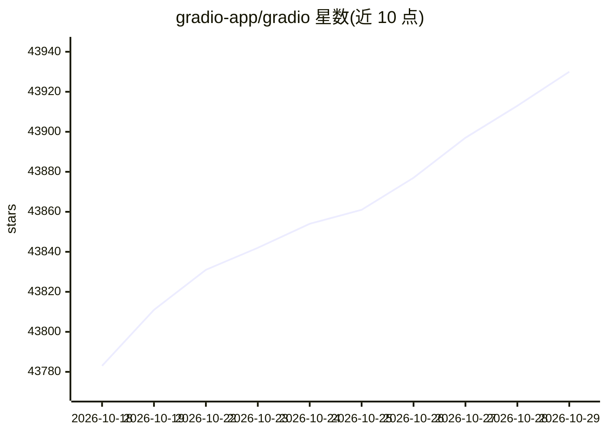

# gradio-app/gradio

⭐ 43,930 · Python · Apache-2.0 · 推送 2026-10-28 · [GitHub](https://github.com/gradio-app/gradio) · [官网](http://www.gradio.app) · 组织维护

**面向 ML 开发者：用纯 Python 快速构建并分享模型演示 Web 应用**

开源 Python 包，用于为机器学习模型、API 或任意 Python 函数生成演示或 Web 应用，无需 JavaScript/CSS 或 Web 托管经验。提供高层 Interface 类、低层 Blocks 布局类和 ChatInterface 聊天界面类，内置 30 余个组件；launch(share=True) 可生成公开 URL 而计算保留在本地。附带 Python/JS 客户端库以编程方式查询应用，支持热重载模式与 --vibe 自然语言编辑，提供 gradio skills add 为 AI 编码助手安装 Gradio 知识技能。要求 Python 3.10+，Apache 2.0 许可。

## 筛选速览

| 维度 | 判定 | 备注 |
|---|---|---|
| AI 角色 | `ai-ecosystem` | LLM/agent 周边工具 |
| 许可风险 | `permissive` | Apache-2.0 |
| 部署形态 | `library` | 以包/库形式分发 |
| 模型依赖 | — | README 未给出锁定关系 |
| 硬件要求 | — | 无带数字的原话,不猜 |
| 安装摩擦 | `low` | 无编译、无系统依赖或容器化 |
| 成熟度 | — | 结构信号不足 |

## 动量与使用信号

- 维护:`active` — 距上次 push 1.4 天,年发版 100,467 位贡献者
- 涨星:近 1 天 **+9**(自 20261016 起算)
- 安装:pypi 包 `gradio` 月下载 5,202,260
- 平台:— · 协议:MCP

## 能力要点

- Interface/Blocks/ChatInterface 三层抽象，30+ 内置组件
- share=True 一键生成公开访问 URL，计算保留本地
- gradio_client（Python）与 @gradio/client（JS）编程查询
- gradio skills add 为编码助手安装 Gradio 技能

## 适用场景

- 为机器学习模型快速搭一个可分享的在线演示
- 在 Jupyter/Colab 中内嵌交互式模型界面
- 用 Blocks 搭建多数据流的定制化 Web 应用
- 为聊天机器人快速生成 Chatbot UI

## 场景标签

 · 领域:机器学习应用开发工具

## 证据(README 行号)

> L21: # Gradio: Build Machine Learning Web Apps — in Python
> L63:  > When developing locally, you can run your Gradio app in hot reload mode , which automatically reloads the Gradio
> L136: Gradio provides a "skill" that enriches AI coding assistants (like Cursor, Claude Code, Codex, etc.) with Gradio-s

## 星数曲线

2026-10-18 43,783 → 2026-10-29 43,930（+147）

---
*卡片 v1 · prompt 1.4 · 生成 2026-10-18 · 置信度 high · 依据 README sha `6f1ca837c72a` · [字段定义](../../DATASET.md)*
