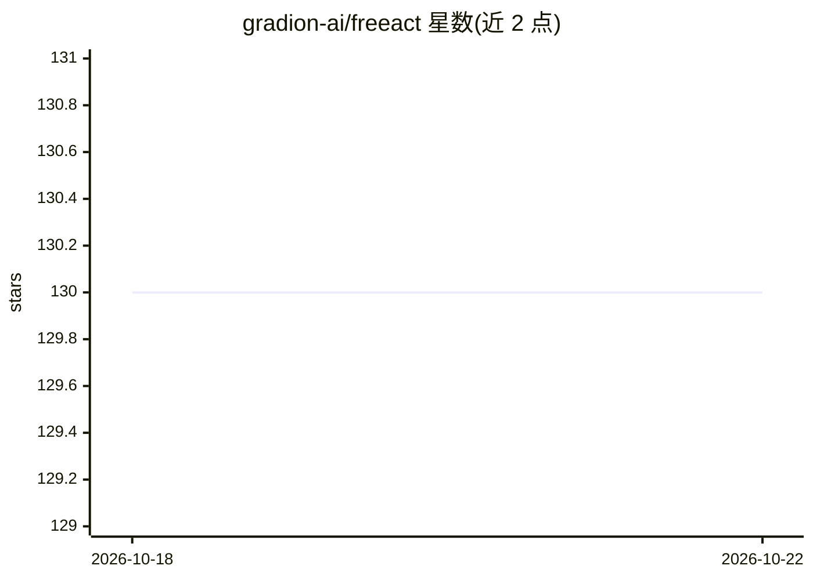

# gradion-ai/freeact

⭐ 130 · Python · Apache-2.0 · 推送 2026-07-22 · [GitHub](https://github.com/gradion-ai/freeact) · [官网](https://gradion-ai.github.io/freeact/) · 组织维护

**通过代码动作执行的通用 AI agent，支持 CLI 与 Python SDK**

Freeact 是一个通用 AI agent，在 ipybox 提供的有状态执行环境中通过代码动作行动：单个 LLM 推理过程即可生成 Python 代码、shell 命令与程序化 MCP 工具调用的任意组合。它从 MCP server schema 生成带类型标注的 Python API，成功的代码动作可保存为可复用工具；支持工具的语义/混合搜索发现、应用级动作审批、子 agent 委派、agent skills 与会话持久化。兼容 Pydantic AI 支持的模型，本地运行，以 CLI 工具与 Python SDK 形式提供。

## 筛选速览

| 维度 | 判定 | 备注 |
|---|---|---|
| AI 角色 | `ai-ecosystem` | LLM/agent 周边工具 |
| 许可风险 | `permissive` | Apache-2.0 |
| 部署形态 | `library` | 以包/库形式分发 |
| 模型依赖 | — | README 未给出锁定关系 |
| 硬件要求 | — | 无带数字的原话,不猜 |
| 安装摩擦 | `low` | 无编译、无系统依赖或容器化 |
| 成熟度 | — | 结构信号不足 |

## 能力要点

- 统一执行接口：单次推理生成 Python 代码、shell 命令与程序化 MCP 调用的组合
- 从 MCP schema 生成带类型的 Python API，成功动作可保存为可复用工具
- 基于 sandbox-runtime 的可选沙箱模式，OS 级限制文件系统与网络
- BM25/向量混合搜索按需发现工具，支持子 agent 委派与会话持久化

## 适用场景

- 构建以代码为核心行动方式的 LLM agent 应用
- 通过 CLI 与本地 agent 对话并执行代码/shell/MCP 工具调用
- 需要动作审批与沙箱限制的 agent 执行场景

## 场景标签

`Agent 框架` · 领域:Agent 开发

## 证据(README 行号)

> L15: Freeact is a lightweight, general-purpose agent that acts via code actions in a stateful execution environment prov
> L50: |**Agent SDK**|Agent harness and Python API for building freeact applications.|

## 星数曲线

2026-10-18 130 → 2026-10-22 130（+0）

---
*卡片 v1 · prompt 1.4 · 生成 2026-10-22 · 置信度 high · 依据 README sha `3839d0008a54` · [字段定义](../../DATASET.md)*
